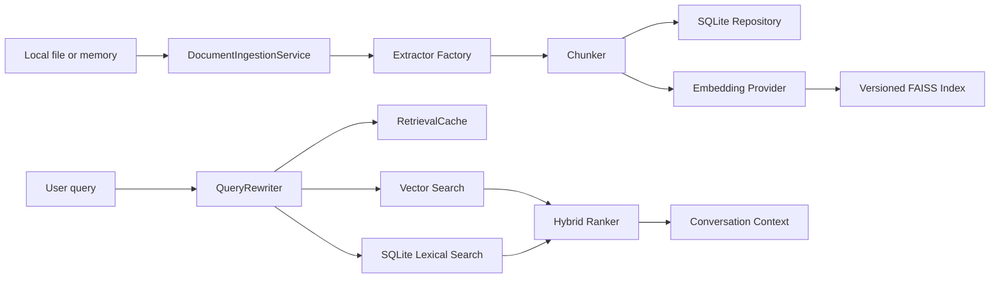
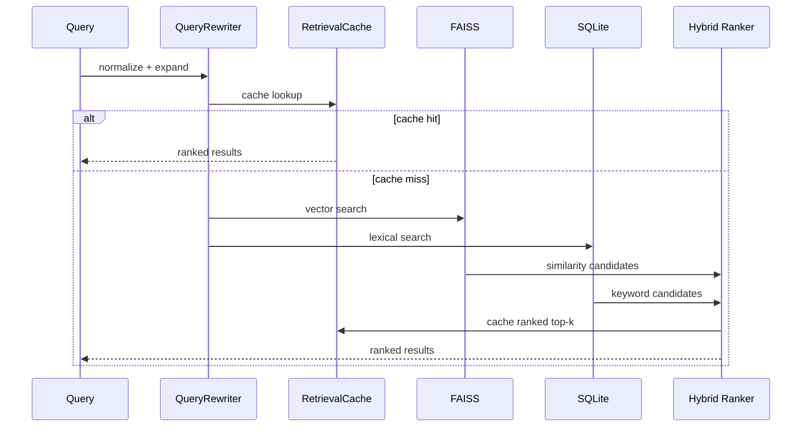

# Fibi v0.18 Architecture

Fibi's priority order is:

```text
Presence > Memory > Personality > Safety > Intelligence > Autonomy
```

## Engine Boundaries

```text
PyQt UI
  -> FibiCore
     -> Routers
        -> CommandRouter
        -> ActionRouter
        -> ChatRouter
        -> MemoryRouter
        -> ContextRouter
        -> ProjectRouter
        -> VoiceRouter
        -> ResponsePipeline
     -> LifeEngine
     -> ObservationEngine
     -> MemoryEngine (legacy compatibility)
     -> RAGMemoryServiceFacade (primary memory)
     -> JournalEngine
     -> PatternEngine
     -> AttentionEngine
     -> HabitEngine
     -> RitualEngine
     -> ReactionLibrary
     -> RepetitionGuard
     -> TimingEngine
     -> MotionEngine
     -> InnerLifeEngine
     -> PreferenceEngine
     -> OpinionEngine
     -> MemoryCareEngine
     -> PrivacySettingsEngine
     -> RelationshipEngine
     -> BoundaryEngine
     -> SocialContextEngine
     -> FastResponseClassifier
     -> RouteDecisionEngine
     -> LocalMicroBrain
     -> ResponseBudgetEngine
     -> ModelHealthEngine
     -> TtsManager
     -> AppSettingsEngine
     -> DataHealthEngine
     -> AssetHealthEngine
     -> AutostartEngine
     -> ActionSettingsEngine
     -> ActionIntentDetector
     -> PermissionEngine
     -> AppIndexEngine
     -> DesktopActionEngine
     -> ActionConfirmationEngine
     -> ActionJournalEngine
     -> VoiceSettingsEngine
     -> SpeechRecognitionEngine
     -> VoiceCommandRouter
     -> VoiceHealthEngine
     -> VoiceSkinSettingsEngine
     -> RvcVoiceSkinEngine
     -> VoiceCacheEngine
     -> SecretSanitizer
     -> ContextEngine
     -> FileReaderEngine
     -> ProjectScannerEngine
     -> ProjectWorkspaceEngine
     -> EditSafetyEngine
     -> DiffGenerator
     -> ProjectEditPlanner
     -> ModelRouter
        -> NvidiaModelEngine (optional cloud, disabled by default)
        -> OpenAICompatibleProvider (optional cloud, disabled by default)
        -> ModelEngine/Ollama (optional local)
     -> PersonalityEngine
```

## Core Decomposition

Fibi v0.17 introduces router boundaries while keeping existing handlers in
place. The goal is an incremental split, not a risky rebuild.

```text
FibiCore.handle_user_message
  -> CommandRouter for slash/local commands
  -> ActionRouter for confirmations and local action intents
  -> ChatRouter for greetings, social check-ins, and local micro-brain replies
  -> ContextRouter for pasted/dropped context
     -> ProjectRouter for workspace commands and edit-intent suggestions
     -> PatchEngine for confirmed low/medium-risk project edits
     -> MemoryRouter for new RAG reads/writes
  -> ModelRouter only after local routes decline
  -> ResponsePipeline for cleanup and speech-safe text
```

## Safe Patch Apply Mode

Fibi v0.18 adds confirmed patch application for user-registered projects.

```text
edit request
  -> ProjectEditPlanner creates reviewed diff/replacement block
  -> PatchSafetyEngine refuses blocked/high-risk files
  -> PatchEngine creates PatchPlan
  -> PatchConfirmationEngine stores pending patch for 5 minutes
  -> user says exact phrase: apply patch confirm
  -> PatchBackupEngine copies originals to data/patch_backups/<patch_id>/
  -> PatchEngine verifies before_hash and writes text file
  -> PatchHistoryEngine records metadata-only event
  -> RAG memory stores short project event, never full code by default
```

Rollback uses the backup metadata and only restores when the current file hash
matches the patch's expected after-hash. If the user or another tool changed the
file after apply, Fibi refuses automatic rollback and asks for manual handling.

Hard boundaries remain:

- no shell commands, `patch`, git, package installs, or automatic tests
- no writes outside the registered project root
- no secret, binary, lockfile, vendor, minified, or delete-file patches
- high-risk auth/payment/database/security/permission patches are manual-only

`FibiCore` still owns some implementation bodies during the transition, but new
tests assert that commands, actions, chat, project, context, and memory calls
pass through the router layer.

### Legacy Memory Cutover

`MemoryEngine` remains available for compatibility and older memory-care
commands. New direct conversation memory writes and relevant-memory retrieval
use `RAGMemoryServiceFacade` through `MemoryRouter`. `LegacyMemoryAdapter`
exposes old `save`, `retrieve`, `summarize`, `save_conversation`, and
`learn_from_message` shapes while internally calling RAG and logging
deprecation warnings.

Legacy migration is dry-run by default:

```powershell
python tools/migrate_legacy_memory_to_rag.py --dry-run
python tools/migrate_legacy_memory_to_rag.py --apply
```

### Local RAG Memory

Fibi v1 includes a local RAG memory subsystem under `fibi/rag/`.

```text
RAGMemoryEngine
  -> RAGMemoryService
     -> RAGMemoryRepository (SQLite metadata)
     -> EmbeddingProvider (local hashing by default)
     -> FAISSVectorStore (persisted vector database)
     -> RAG evaluation utilities (offline corpus/train quality checks)
```

Boundaries:

- `RAGMemoryRepository` owns only SQLite metadata and audit events.
- `EmbeddingProvider` owns local text-to-vector conversion.
- `FAISSVectorStore` owns FAISS index persistence and vector search.
- `RAGMemoryService` owns orchestration, duplicate detection, scoring, top-k
  retrieval, and conversation context assembly.
- RAG evaluation utilities own filesystem evaluation only; they do not call
  NVIDIA services, cloud judges, or external retrievers.

Storage stays local:

```text
data/fibi_memory.db
data/rag/fibi_rag.faiss
data/rag/fibi_rag_ids.json
```

The scoring policy combines similarity, importance, confidence, and recency.
Similarity and duplicate thresholds are configurable through `RAGConfig`.
Each memory can carry source/provenance fields such as source id, local URI,
source title, timestamp, metadata, and provenance JSON. Conversation context
includes compact source labels so Fibi can reference memories with traceable
origin when needed.

Fibi's local personal-memory RAG is intentionally different from NVIDIA NeMo
Retriever. NeMo Retriever is appropriate for multimodal document corpora and
service-backed document search; Fibi's built-in path is a small local SQLite
plus FAISS memory store for personal facts, projects, habits, goals, and
important moments.

#### Next-Generation Local RAG



Data flow:

1. A memory or document enters the ingestion/service boundary.
2. Extractors read supported local formats. Text and Markdown are native; DOCX
   uses local XML extraction; PDF uses optional local PDF libraries; image,
   audio, and video paths record future-ready metadata when extraction is not
   enabled.
3. Chunker creates overlapping chunks.
4. SQLite stores metadata, source/provenance, document rows, chunk rows,
   expiration policy, and audit events.
5. The embedding provider creates local vectors.
6. FAISS receives incremental additions and writes a version manifest.
7. Retrieval rewrites the query locally, checks the cache, combines vector and
   keyword scores, applies thresholds, and returns top-k context.

Retrieval lifecycle:



Index lifecycle:

- Add: insert SQLite memory, embed one chunk, incrementally append to FAISS,
  update manifest version, clear retrieval cache.
- Update/delete/expiration: mutate SQLite, rebuild active FAISS index, update
  manifest version, clear retrieval cache.
- Startup: compare active-memory count with vector count and rebuild if stale.

Memory lifecycle:

- Create from conversation, explicit memory, or document chunk.
- Store category, content, source id, source URI, provenance, confidence,
  importance, timestamps, and optional expiration.
- Retrieve through hybrid ranking and mark accessed.
- Expire or soft-delete locally; no cloud services are called.

### Manual Action Core

Fibi v0.12 adds safe, direct, user-commanded actions. The action pipeline runs
before model routing:

```text
user message
  -> slash/local commands
  -> pending action confirmation
  -> local action intent detector
  -> permission engine
  -> desktop action engine or confirmation/block reply
  -> action journal
  -> normal chat pipeline only if no action intent exists
```

Manual actions are direct-user-only. Model-generated text is never fed into the
action detector. The action layer does not read screens, messages,
notifications, or clipboard contents; it does not type, click coordinates,
delete files, modify files, run terminal commands, purchase things, or send
messages.

### Routing Stability

Fibi v0.15.1 centralizes route labels in `RouteDecisionEngine`. The engine is
side-effect free: it records the winning route and why, but it does not call
models or run actions.

```text
user message
  -> slash/local commands
  -> pending action confirmation
  -> action intent detector
  -> local action/confirmation/block
  -> fast response classifier
  -> local micro-brain or model router
```

Hard rules: commands, date/time, volume, app/search actions, memory/privacy,
project, context, voice, route, and TTS commands never call the model router.
`/route last` returns the last route snapshot. `/route test <message>` predicts
a route locally without sending anything to the model.

`ModelHealthEngine` places Ollama on a short cooldown after timeout-like
failures so repeated complex questions do not repeatedly wait on a sleeping
provider.

`TtsManager` decides speech priority before the UI starts a background speech
thread. Bubbles render before TTS starts. Utility replies are low priority and
skip voice by default.

Safe actions include opening known indexed apps, opening/searching public web
URLs, media volume keys, time/date, app-index refresh/list/search. Risky actions
such as screenshots and shutdown are disabled by default and require exact
confirmation when enabled. Blocked actions are refused locally.

### Voice Command Mode

Voice input is push-to-talk only in v0.13. The mic button or `/listen` starts a
short listen in a background thread; there is no always-listening loop and no
wake-word listener.

```text
mic button or /listen
  -> SpeechRecognitionEngine
  -> VoiceCommandRouter
  -> FibiCore.respond(transcript)
  -> normal slash/action/model pipeline
```

Voice commands never bypass the Manual Action Core. Safe actions, risky
confirmations, blocked actions, memory commands, privacy commands, and model
routing all use the same path as typed text. Low-confidence action transcripts
are not executed; Fibi asks what she heard. Audio is not saved by default and
transcripts are not journaled by default.

### Optional Local RVC Voice Skin

RVC voice skin support is optional, disabled by default, and local-only.

```text
reply text
  -> cleanup / TTS-safe text
  -> edge-tts base audio
  -> optional RVC conversion
  -> pygame playback
```

`VoiceSkinSettingsEngine` stores local RVC paths and backend choices in
`data/voice_skin_settings.json`. `RvcVoiceSkinEngine` validates `.pth` and
`.index` files and wraps backend-specific conversion attempts. Missing
dependencies or failed conversion never crash Fibi; playback falls back to base
edge-tts. `VoiceCacheEngine` caches short converted lines in `data/voice_cache`
when enabled.

No model files are uploaded. WebUI mode is reserved for localhost-only adapters.
Large voice model files are ignored by git.

### Context Drop And File Awareness

Fibi v0.14 accepts only context the user explicitly hands over: pasted text,
manual selected text commands, and dropped safe text/code files. There is no
secret screen reading, no automatic clipboard reading, and no screenshots.

```text
paste/drop/manual command
  -> FileReaderEngine or ContextEngine
  -> SecretSanitizer for previews/model hints
  -> temporary ContextSession
  -> model hint only when user asks about context
```

FileReaderEngine reads only supported text-like files up to 1 MB. It does not
execute, import, scan neighboring files, or recurse folders. Context remains
temporary unless the user explicitly runs `/context remember last confirm`, in
which case Fibi stores a short summary rather than raw full content.

### Project Workspace Mode

Fibi v0.15 registers only user-approved project folders. The scanner walks the
registered root and collects metadata plus small sanitized previews for safe
text files. It ignores generated folders, hidden/system-like project folders,
virtualenvs, caches, binaries, and secret files.

```text
/project add <path>
  -> ProjectWorkspaceEngine
  -> ProjectScannerEngine
  -> local project_workspaces.json
  -> optional sanitized project summary as model hint
```

Project mode does not modify files, run commands, install packages, perform git
operations, or scan outside registered roots. `/project read <relative_path>`
must stay inside the active project and still goes through the safe file reader.

### Safe Project Edit Suggestions

Fibi v0.16 adds manual-only coding help on top of registered project workspaces.

```text
user message
  -> slash/local commands
  -> active project check
  -> edit intent detection
  -> EditSafetyEngine
  -> safe ProjectWorkspaceEngine file read
  -> DiffGenerator replacement block/unified diff
  -> edit journal metadata
  -> manual-only response
```

`ProjectEditPlanner` owns edit intent detection, target-file discovery,
clarification prompts, last suggestion storage, and metadata journaling.
`EditSafetyEngine` blocks secrets, destructive changes, terminal/run/install
requests, auth bypasses, and malware-like requests. It marks auth, payment,
security, database, and migration changes as high risk. `DiffGenerator` renders
unified diffs and copy-paste replacement blocks only; it has no apply function.

The hard boundary for v0.16 is no file writes, no command execution, no package
installs, and no autonomous edits. Future apply mode must be a separate,
confirmed permission layer.

### Life Engine

Owns persistent mood, presence state, idle timing, blink timing, and animation
phases. Mood transitions are deterministic and remain outside the language
model. It also owns local companion bond values, nap/energy state, click/drag
frequency, saved position, nest confidence, ritual state, time curves, and creature presence states. UI expressions
are mapped from richer internal moods.

### Memory Engine

Uses local SQLite at `data/fibi_memory.db`. It stores categorized memories and
conversation events. Clear statements such as "my name is" or "I am building"
can be learned; speculative facts are not inferred.

The schema is in `fibi/engines/schema.sql`. Sample data is provided separately
at `data/sample_memories.json` and is never imported automatically.

### Journal Engine

Stores small sampled events in `journal_entries` inside the existing local
SQLite database. It records continuity-worthy moments rather than a continuous
timeline and can summarize Fibi's day without a model call.
Summaries are persisted in `daily_summaries` and use sampled journal data only.

### Pattern Engine

Uses transparent local thresholds over existing memories and journal events.
It can notice repeated projects, late coding, frequent VS Code samples, errors,
long idle gaps, greetings, and long-break returns. Pattern output contains a
name, confidence, summary, and optional reaction.
It also updates bounded affinity scores only for projects already known through
memory or journal entries.

### Ritual Engine And Reaction Library

Ritual Engine owns morning, evening, daily-return, project-return, and shutdown
eligibility. Trigger timestamps persist locally and prevent stacked greetings.
Reaction Library selects curated lines by category, time, bond, cooldown, and
recent repetition without calling the model.

### Motion And Timing Engines

Motion Engine turns mood, presence, attention, rituals, habits, events, time,
and cooldown state into `MotionIntent`. The sprite applies offset and scale in
its existing timer. Timing Engine returns presentation metadata only; delays use
`QTimer` and never sleep on the UI thread.

### Expression, Bubble, Repetition, And Silence

Expression Controller owns minimum duration, temporary overrides, talking, and
return-to-mood behavior. The bubble provides lightweight typing, auto-hide, and
TTS-aware visibility. Repetition Guard stores bounded local buffers. Direct
messages bypass it; low attention, unchanged context, focused coding, naps, and
repeated ambient lines prefer motion or silence.

### Inner Life, Dreams, Preferences, And Opinions

Inner Life Engine creates short private thoughts from trusted local context:
mood, time, journal events, known memories, known projects, nest state, and
bond. Most thoughts stay internal. Rare thought bubbles must pass attention and
repetition gates.

Dreams are stored in `fibi_dreams` and mirrored only as non-factual
`dream_fragment` inner-life entries. Dreams may be whimsical, but they never
write to `memories` as facts, projects, beliefs, goals, or habits.

Preference Engine slowly updates local creature preferences from repeated
evidence such as nest placement, known project affinity, late-night sessions,
poke spam, and success moments. Preferences are small inclinations, not user
profiles.

Opinion Engine v0.02 forms playful stable opinions only from memories, journal
events, patterns, and preferences. Unsupported contradictions return silence or
low-confidence hints instead of fake certainty.

Emotional weighting raises the importance of success, frustration, long or late
work, tiredness, quit/delete signals, celebrations, and known projects. Ordinary
chat remains light.

### Memory Care, Notebook, And Commands

Memory Care Engine is the user-facing control layer for local state. It can
list, search, inspect, edit, delete, forget categories, mark memories important,
reduce importance, export a local bundle, validate imports, clear dreams, clear
journal data, clear preferences/pattern tables, and perform a full local reset
only with the exact confirmation phrase.

The Notebook UI is a small PyQt dialog opened from the floating window. It shows
memories, journal entries, dreams, preferences, and projects without calling the
model. It can edit/delete selected memories, export local data, clear dreams,
and clear journal entries.

Slash commands are handled in `FibiCore` before the normal response pipeline and
are never sent to Ollama.

### Privacy Settings Engine

Privacy Settings Engine stores feature permissions in `data/fibi_state.json`
while preserving unknown legacy fields. Defaults are local-first: foreground app
and window title observation are enabled, clipboard observation is disabled, and
journal, dreams, inner thoughts, patterns, idle bubbles, TTS, sounds, Ollama,
and memory learning are enabled.

Observation is filtered after sampling. Disabled journaling skips new journal
writes. Disabled dreams, thoughts, patterns, idle bubbles, Ollama, TTS, and
sounds stop those feature paths locally.

### Relationship, Boundary, And Social Context Engines

Relationship Engine stores Fibi's local social stance: familiarity, teasing
permission, comfort with silence, quiet/playful preferences, annoyance, warmth,
distance, and interaction style. It is non-romantic and changes slowly. Trust
and affection can increase warmth; boundaries increase distance immediately.

Boundary Engine detects soft and hard boundary signals, manages temporary quiet
mode, and persists boundary/quiet state locally. Hard boundaries such as "shut
up" or "leave me alone" never go to the model.

Social Context Engine filters candidate reactions before display. It can allow,
replace, or silence a line. Teasing is blocked during frustration, tiredness,
high annoyance, active boundaries, quiet mode, low familiarity, or quiet
companion style. Quiet mode blocks ambient speech while allowing direct user
messages.

Apologies are short and cooldown-limited: no long explanations, no guilt, no
"but I was trying" behavior.

### Fast Reply Router And Model Providers

`FibiCore.respond()` classifies input before heavy work. Slash commands,
greetings, thanks, goodbye, success, frustration, tiny status checks, and simple
chat use local paths and never call Ollama, cloud providers, memory retrieval,
patterns, dreams, or cloud APIs.

Local Micro-Brain is deterministic and covers common offline cases. It uses
mood, time, relationship state, quiet preferences, and small curated lines.

Response Budget Engine assigns hard budgets to categories. If budget or model
health says a provider is unsafe to wait for, Fibi returns a local fallback.

Model Router handles non-local model work:

1. optional NVIDIA when `allow_cloud_model` and `allow_nvidia_api` are both true
2. optional Ollama when enabled
3. local fallback

Cloud providers are provider-agnostic. NVIDIA and generic OpenAI-compatible
endpoints are optional and disabled by default. They time out quickly and never
log API keys.

Model Health Engine tracks Ollama/cloud availability, latency, consecutive
failures, disabled-until state, last successful provider, and average reply
latency. `/model status` and `/perf` expose tiny summaries.

Cloud Context Sanitizer builds tiny prompts for NVIDIA. It permits only Fibi's
identity summary, mood, user message, and optional short memory hints. It blocks
raw databases, journal/dream/inner-life dumps, clipboard, screenshots, secrets,
API keys, local file paths, and full logs.

Performance logs include router start/end, provider, model, cloud permission,
NVIDIA/Ollama duration, fallback use, fast-path use, and final reply time.

Warmup Engine runs startup checks in the background so the UI can appear first.
Fibi can answer greetings before warmup completes.

### Desktop App Integration

The PyQt window owns daily desktop behaviors: system tray, settings dialog,
first-run setup, hide/show, and close-to-tray. If the tray is unavailable or the
tray icon asset is missing, the app continues normally with a fallback icon or
no tray.

App Settings Engine persists local app settings in `fibi_settings.json` under
the configured data folder. Privacy toggles still live in Privacy Settings
Engine and remain local.

Autostart Engine uses the Windows Startup folder by writing `Fibi.cmd`. It is
off by default and requires `/autostart on confirm`.

Data Health Engine checks state, settings, memory DB, journal, dream/inner-life
tables, exports, schema presence, and DB closure. Asset Health Engine checks
required expression PNGs plus optional blink, talking, sounds, and tray icon
fallbacks.

`FIBI_DATA_DIR` can move state, memory, journals, dreams, exports, and settings
to a portable location.

Shutdown marks state as clean; startup can detect an unclean previous run and
uses a gentle recovery line.

### Attention Engine

Scores whether Fibi should react and applies cooldowns by reaction type. Direct
messages always receive attention; silence remains valid for idle and repeated
touch events. Important success, frustration, or wake events can override a
cooldown.

### Habit Engine

Selects deterministic local creature habits from mood, time, sampled app, and
patterns. Habit lines do not call Ollama and are journaled only occasionally.

### Observation Engine

Reads only the foreground process/title and local time when a response needs
context. It does not record an activity timeline. Clipboard access requires an
opt-in engine setting and explicit permission for each read.

### Personality Engine

Owns identity, values, tone, memory formatting, and contextual reactions. The
model receives prepared context but cannot redefine Fibi's identity or memory.
It also creates natural memory hints and evidence-gated gentle disagreement.
Bond state can adjust warmth, teasing, and honesty, but cannot create memories
or redefine identity.

### Do Not Invent Enforcement

- Inner thoughts are stored as `inner_life_entries`, not facts.
- Dreams are stored as `fibi_dreams`, not facts.
- Project references must come from memory, journal, or known project affinity.
- Model output does not create project memories.
- Explicit memory learning remains limited to clear user statements handled by
  `MemoryEngine.learn_from_message`.
- Fibi's identity, values, and disagreement rules live in deterministic engines,
  not in the LLM.
- Relationship and boundary state remain local and do not create facts.
- Quiet/boundary slash commands are handled before the model.
- Greeting and model/cloud slash commands are handled before any provider.
- NVIDIA is an optional language tool; Fibi identity and privacy rules remain
  local.

### Model Engine

Calls local Ollama with short prompts, bounded output, and a hard timeout. It is
a replaceable language component rather than Fibi's source of character.

## Contracts

Python contracts are in `fibi/engines/types.py`. Matching TypeScript contracts
for future frontends and integrations are in `fibi/types/fibi.ts`.

## Local-First Safety

- Memory stays in a local SQLite file.
- Journal entries stay in the same local SQLite file.
- Session continuity stays in `data/fibi_state.json`.
- Bond, nap, energy, and window position stay in `data/fibi_state.json`.
- No cloud service is required.
- Clipboard access defaults to disabled.
- Observation is sampled only when needed.
- No screenshots, private-message reading, notification reading, or continuous
  application timeline is implemented.
- Patterns are derived from already-sampled local data.
- Model failures use local personality fallbacks.
- Click, drag, nap, wake, habit, celebration, and comfort reactions are local.
- No autonomous desktop control, calendar, email, or productivity integration
  was added.
