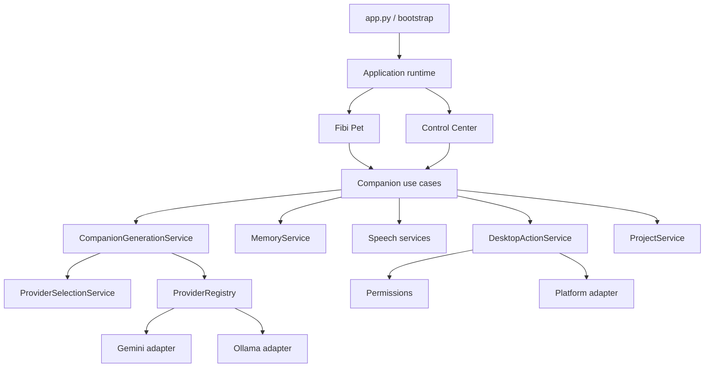

# Fibi Companion Architecture

This document describes the intended maintainable product architecture. The
current detailed audit is in [ARCHITECTURE_AUDIT.md](ARCHITECTURE_AUDIT.md).
Historical implementation detail remains in the root `ARCHITECTURE.md` until
compatibility migration is complete.

## Runtime Shape

Fibi is a modular desktop application, not an autonomous agent platform.

## Ownership Rules

- `app`: constructs services and owns startup/shutdown.
- `ui`: renders state and emits user intents; it does not implement business
  policy or directly open files/processes.
- `core`: coordinates use cases, routing, responses, and application events.
- `services`: implements provider, memory, speech, action, and project contracts.
- `permissions`: classifies capabilities and confirmation requirements.
- `diagnostics`: reports health without exposing private payloads.
- `platform`: contains OS-specific integration.
- `plugins`: validates and hosts capability-limited extensions.

## Current Compatibility Map

| Target boundary | Current implementation |
|---|---|
| App/runtime | `app.py`, `bootstrap.py`, `main.py`, `FibiCore.__init__` |
| Pet | `ui/fibi_pet_window.py` plus inherited `FibiWindow` behavior |
| Control Center | dialogs and window behavior in `ui/fibi_window.py` |
| Companion/router | `engines/core.py`, `engines/routers/` |
| Providers | `services/providers/` with compatibility adapters over `model_engine.py` and `providers/gemini_provider.py` |
| Memory | `memory_engine.py`, `memory_care_engine.py`, `rag/` |
| Speech | `speech_recognition_engine.py`, `voice/`, wake/RVC engines |
| Actions | action intent, permission, confirmation, app index, desktop action engines |
| Projects | project workspace/scanner/file reader/edit/check engines |
| Platform | currently embedded in action, app-index, observation, and autostart engines |

## Dependency Direction

UI depends on core contracts. Core depends on service protocols. Concrete
services depend on repositories and platform adapters. Infrastructure must not
import UI. Provider output never executes actions directly. Model text is data,
not authority.

## Lifecycle

`fibi.app.composition` is the application composition root. It resolves runtime
paths and the optional environment file once, constructs an explicit
`ApplicationServices` graph, and injects that graph into `FibiCore`.
`ApplicationRuntime` owns the graph and provides idempotent `start()` and
`shutdown()` operations. The Pet receives its core from this runtime, and the
Control Center opened by the Pet reuses the same core. GUI smoke verifies the
provider registry, memory, TTS, action, project, and STT identities.

## Provider Boundary

`fibi.services.providers` is the experimental 0.4 provider API. Core prepares a
`GenerationRequest`; the generation service resolves the manually selected
provider, calls its adapter, and returns a normalized `GenerationResult`.
Provider adapters own SDK-specific translation only. They do not own Fibi's
personality, memory policy, privacy policy, routing, or UI.

Provider IDs are stable lowercase strings: `gemini` and `ollama`. Selection is
persisted by `ProviderSelectionService` and never changes because generation
failed. Automatic fallback is disabled by default. When the user explicitly
enables fallback, only eligible temporary failures may use the configured
fallback, the response says which provider answered, and the selected provider
remains unchanged.

Provider command flow is `FibiCore` command parsing -> registry/selection/
generation/diagnostics use case -> safe text presentation. `/provider list`
reads normalized `ProviderModelMetadata` from the registry; ordinary status
uses cached diagnostics and never probes a network. Explicit provider tests use
the selected provider with fallback disabled. The manual benchmark uses
provider IDs explicitly, records no diagnostics, and cannot change persisted
selection.

The request contains prepared text and already-approved context summaries; it
never contains API keys or service objects. `ProviderDiagnostics` retains only
safe metadata such as IDs, model, latency, retry count, error category, and
fallback/search flags. Prompts and responses are deliberately not retained.

`ModelRouter` is now a deprecated forwarding facade. It constructs no provider,
implements no fallback, persists no selection, and owns no mutable diagnostics.
Its compatibility properties project the authoritative service snapshot. The
factory can attach a non-persisting subsystem for verified old direct callers;
production Core and UI use the shared runtime services directly. Removal is
eligible after the remaining direct-constructor tests and external compatibility
window described in
[PROVIDER_COMPATIBILITY_CLEANUP.md](architecture/PROVIDER_COMPATIBILITY_CLEANUP.md).

The existing UI submission worker remains responsible for executing
`FibiCore.respond` away from the Qt thread and suppressing stale results. The
provider subsystem is synchronous by design and creates no executor per
request; runtime shutdown therefore continues to own the established worker
lifecycle.

Feature workers remain opt-in. Wake-word work must not start unless the saved
setting enables it. Core shutdown currently closes legacy resources; the
runtime guards that call so it occurs once and also performs best-effort cleanup
after partial construction.

Memory Migration Stage 1 also attaches exactly one read-only
`MemoryQueryService` after Core has initialized its existing compatibility RAG
service. Its adapters reuse the runtime-owned legacy and RAG objects. The new
boundary is not called by current Core retrieval, and its shadow comparison and
Context Broker preview are both disabled by default.

## Composition Guidance

Contributors adding a top-level service should define only the small structural
protocol its consumers need, construct the concrete adapter in
`fibi/app/composition.py`, add it as a typed `ApplicationServices` field, and
cover identity and cleanup behavior. Do not introduce a global service locator:
hidden dependencies and process-wide state make tests and lifecycle behavior
unpredictable. A DI framework was also rejected because this graph is explicit,
small enough to wire in Python, and should remain approachable to contributors.

Direct `FibiCore(...)` construction remains supported as a compatibility path.
It will be narrowed gradually as each capability moves behind a tested service
boundary; the core is not being split in one high-risk rewrite.

## Data And Privacy

- Writable data lives under the configured runtime-data directory.
- SQLite is the intended authoritative store for supported personal memory.
  The current runtime still has overlapping legacy and RAG representations, so
  cross-store edit/delete guarantees are not yet complete.
- Secrets come from explicit environment/config loading and are never logged.
- Raw audio is not retained.
- No telemetry is sent by default.
- Project and plugin access is capability-limited and user-approved.

## Memory Boundary

Fibi's target product memory is deliberately small: approved facts,
preferences, project memories, and selected discussion summaries. Notes,
registered projects, temporary conversation, companion configuration,
relationship presentation state, operational audits, and derived indexes have
separate owners. FAISS is optional derived acceleration and never an
authoritative copy.

The current system is in a compatibility phase with legacy memory, journal,
structured extraction, and RAG paths. The complete audit, target contract,
privacy policy, and non-destructive migration stages are documented in:

- [Memory system audit](architecture/MEMORY_SYSTEM_AUDIT.md)
- [Memory target architecture](architecture/MEMORY_TARGET_ARCHITECTURE.md)
- [Memory migration plan](architecture/MEMORY_MIGRATION_PLAN.md)
- [Memory Stage 1 read boundary](architecture/MEMORY_STAGE_1_READ_BOUNDARY.md)
- [Memory shadow comparison](architecture/MEMORY_SHADOW_COMPARISON.md)
- [Memory privacy model](security/MEMORY_PRIVACY_MODEL.md)
- [ADR 0009](decisions/0009-authoritative-user-controlled-memory.md)
- [ADR 0010](decisions/0010-read-only-memory-query-boundary.md)

The future Context Broker remains the intended route from approved memory to a
generation request. Stage 1 includes only a disconnected preview; it is not a
production authority and sends no context to a provider. Do not add new memory
writers while the staged migration is pending.

## Migration Strategy

1. Add protocols in a stable public package.
2. Introduce a composition root that constructs existing engines.
3. Add adapters and contract tests around current implementations.
4. Move route handlers out of `FibiCore` by product capability.
5. Split Pet/Control Center presenters while sharing services.
6. Consolidate memory and provider paths.
7. Introduce platform adapters.
8. Remove deprecated imports only after a documented compatibility window.

No big-bang directory move is planned.
