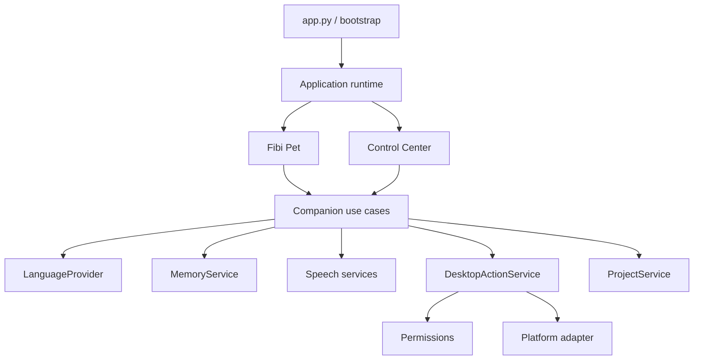

# Fibi Companion Architecture

This document describes the intended maintainable product architecture. The
current detailed audit is in [ARCHITECTURE_AUDIT.md](ARCHITECTURE_AUDIT.md).
Historical implementation detail remains in the root `ARCHITECTURE.md` until
compatibility migration is complete.

## Runtime Shape

Fibi is a modular desktop application, not an autonomous agent platform.

## Ownership Rules

- `app`: constructs services and owns startup/shutdown.
- `ui`: renders state and emits user intents; it does not implement business
  policy or directly open files/processes.
- `core`: coordinates use cases, routing, responses, and application events.
- `services`: implements provider, memory, speech, action, and project contracts.
- `permissions`: classifies capabilities and confirmation requirements.
- `diagnostics`: reports health without exposing private payloads.
- `platform`: contains OS-specific integration.
- `plugins`: validates and hosts capability-limited extensions.

## Current Compatibility Map

| Target boundary | Current implementation |
|---|---|
| App/runtime | `app.py`, `bootstrap.py`, `main.py`, `FibiCore.__init__` |
| Pet | `ui/fibi_pet_window.py` plus inherited `FibiWindow` behavior |
| Control Center | dialogs and window behavior in `ui/fibi_window.py` |
| Companion/router | `engines/core.py`, `engines/routers/` |
| Providers | `engines/model_router.py`, `model_engine.py`, `providers/` |
| Memory | `memory_engine.py`, `memory_care_engine.py`, `rag/` |
| Speech | `speech_recognition_engine.py`, `voice/`, wake/RVC engines |
| Actions | action intent, permission, confirmation, app index, desktop action engines |
| Projects | project workspace/scanner/file reader/edit/check engines |
| Platform | currently embedded in action, app-index, observation, and autostart engines |

## Dependency Direction

UI depends on core contracts. Core depends on service protocols. Concrete
services depend on repositories and platform adapters. Infrastructure must not
import UI. Provider output never executes actions directly. Model text is data,
not authority.

## Lifecycle

One application runtime owns one instance of each shared service. The Pet and
Control Center subscribe to it. Every worker is registered, cancellable, and
joined during shutdown. Optional services are lazy and report unavailable
rather than failing application startup.

## Data And Privacy

- Writable data lives under the configured runtime-data directory.
- SQLite is the authoritative store for supported personal memory.
- Secrets come from explicit environment/config loading and are never logged.
- Raw audio is not retained.
- No telemetry is sent by default.
- Project and plugin access is capability-limited and user-approved.

## Migration Strategy

1. Add protocols in a stable public package.
2. Introduce a composition root that constructs existing engines.
3. Add adapters and contract tests around current implementations.
4. Move route handlers out of `FibiCore` by product capability.
5. Split Pet/Control Center presenters while sharing services.
6. Consolidate memory and provider paths.
7. Introduce platform adapters.
8. Remove deprecated imports only after a documented compatibility window.

No big-bang directory move is planned.
