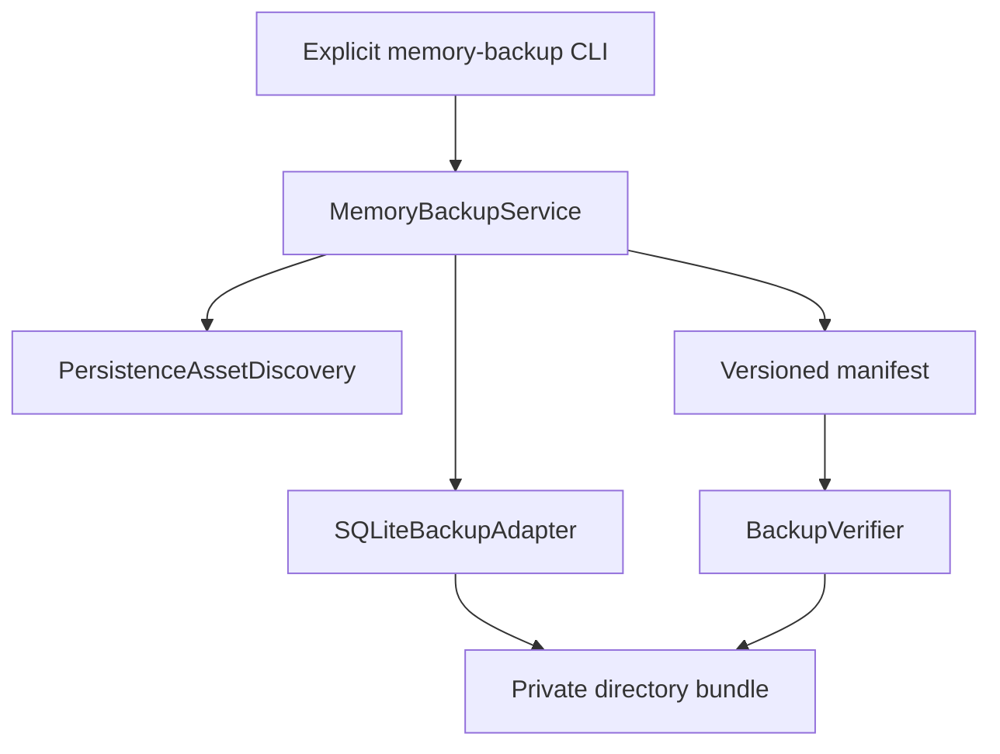

# Memory Backup Architecture

Status: implemented as an explicit local service. It is not part of normal
startup and does not authorize Memory Migration Stage 3.

## Boundary



The subsystem is under `fibi.memory_backup`. Callers inject discovery,
snapshot, verification, cancellation, clock, ID, and fault boundaries. It has
no provider, UI, plugin, network, memory-write, migration-import, background
worker, or scheduled execution dependency.

## Persistence Classification

| Logical asset | Classification | Policy | Reason |
| --- | --- | --- | --- |
| `data/fibi_memory.db` | primary persistence | required SQLite snapshot | Contains legacy memory, RAG records/events/documents, journal, preferences, opinions, and inner-life tables. Loss would destroy user-owned state. |
| `data/fibi_state.json` | migration support | optional verified copy | Contains memory consent/privacy state mixed with companion configuration. Useful for interpretation, but absence cannot invalidate the database snapshot. |
| `data/memory/memory_deletion_log.jsonl` | migration support | optional verified copy | Deletion evidence may be needed during a future migration review. |
| RAG FAISS/NumPy files, ID map, vector manifest | derived rebuildable | deliberately omitted | Authoritative SQLite records must survive without an index. Stale indexes must never override restored records. |
| exports and review reports | out of scope | excluded | User-created secondary copies need their own retention and deletion policy. |
| logs, audio, screenshots, caches, build output | out of scope | excluded | They are not migration authority and may disclose unrelated private data. |

Asset discovery is declarative and does not scan arbitrary contents beneath
the data root. Missing optional support assets are tolerated. A missing primary
database blocks creation before a destination bundle is finalized.

## SQLite Strategy

The source opens through a read-only SQLite URI. `Connection.backup()` creates
a transactionally consistent destination snapshot and includes committed WAL
state without copying a live `.db` file directly, changing source journal mode,
or destructively checkpointing its WAL.

After backup completes, only the destination snapshot is normalized to a
self-contained rollback journal. Source bytes, WAL bytes, schema, rows, access
counters, and timestamps remain untouched. The destination receives
`PRAGMA quick_check` by default or `PRAGMA integrity_check` when explicitly
requested. Schema fingerprint, table-name set, SQLite `user_version`, size, and
SHA-256 are recorded.

## Bundle

```text
fibi-memory-backup-<UTC timestamp>-<random suffix>/
|-- manifest.json
|-- databases/
|   `-- memory.sqlite
`-- metadata/
    |-- companion_state.json          # optional
    `-- memory_deletion_audit.jsonl   # optional
```

`manifest.json` uses `fibi.memory-backup.v1`. It contains logical IDs,
logical relative source locations, classification, strategy, required flags,
artifact-relative paths, sizes, checksums, SQLite structural metadata, and
verification state. It never contains rows, memory text, a username, absolute
path, prompt, credential, environment value, or provider context.

## Creation And Finalization

1. Require private-output confirmation.
2. Validate the local destination and reject unsafe/source-controlled roots.
3. Create a uniquely named hidden staging directory and `INCOMPLETE` marker.
4. Snapshot/copy declared assets.
5. Verify each artifact and write the manifest atomically.
6. Verify the complete staging bundle as untrusted input.
7. Remove the incomplete marker and rename the directory within one parent.
8. Verify the finalized bundle again.

`os.replace` gives the safest feasible same-parent Windows finalization. A
directory rename is not claimed to be transactional across volumes or against
all external filesystem interference. Atomic replacements use a short bounded
retry for transient Windows scanner/indexer locks. Cleanup tracks which staging
and final directories this invocation actually created, so a colliding
pre-existing directory is never removed. A failed final verification is
removed when safe cleanup is enabled. Existing bundles are never overwritten.

## Cancellation And Faults

Cancellation is checked between stages and during SQLite backup progress. It
never finalizes an incomplete bundle. `FaultInjector` provides deterministic,
test-only failure points without production randomness or a general task
framework.

## Runtime And Removal

Normal runtime composition does not import or construct this subsystem.
Removing `fibi.memory_backup`, its CLI, tests, architecture rules, and docs
restores the previous code path. Previously created private bundles must remain
untouched; rollback never means deleting user backups.
