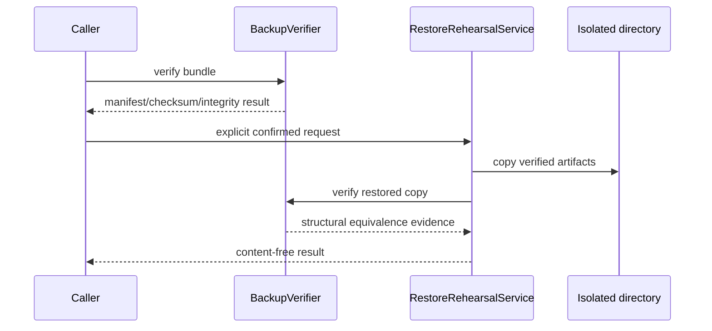

# Memory Restore Rehearsal

Status: isolated rehearsal only. Live restore is not implemented.

## Purpose

`RestoreRehearsalService` proves that a verified backup can produce an
independent, structurally valid copy of Fibi's protected persistence state. It
does not replace the active database, change runtime paths, rebuild indexes,
import records, or approve a migration.

## Destination Rules

The resolved rehearsal destination must not be:

- the active data root, any parent of it, or any child beneath it;
- the backup bundle, a parent of it, or a path inside it;
- the repository root, a parent of it, or any source-controlled child;
- a file, symlink, junction, or reparse-point chain;
- an existing rehearsal directory with the generated name.

Default execution uses a uniquely named system temporary directory. Custom
destinations require private-output confirmation. No command for live,
overwrite, or in-place restore exists.

## Equivalence Evidence

Rehearsal verifies manifest schema/version, required assets, file size,
SHA-256, SQLite quick/integrity check, `user_version`, schema fingerprint,
table-name set, and required-asset presence. The evidence file records only
booleans, counts, timestamps, backup ID, and schema version. It contains no
record value, checksum, absolute path, or database row.

The restored database bytes normally equal the backed-up database bytes because
rehearsal copies the already verified snapshot. Structural metadata is checked
again so a checksum-valid but semantically incompatible manifest is rejected.
Derived indexes may be absent and never determine rehearsal success.

## Cleanup

By default the created rehearsal is removed after verification. Cleanup accepts
only the exact generated prefix directly under the approved destination and
refuses link-like paths. It also requires per-invocation ownership, so a
pre-existing staging-name collision is preserved rather than treated as this
run's partial output. Unrelated files are never deleted. `--keep` preserves the
isolated result for explicit private inspection.

## Limits

Rehearsal demonstrates recoverability into an independent directory. It does
not demonstrate application-level behavior after a live cutover, coordinated
deletion, migration conflict handling, importer rollback, or user-approved live
restoration. Those remain separate Stage 3 and recovery-product decisions.
