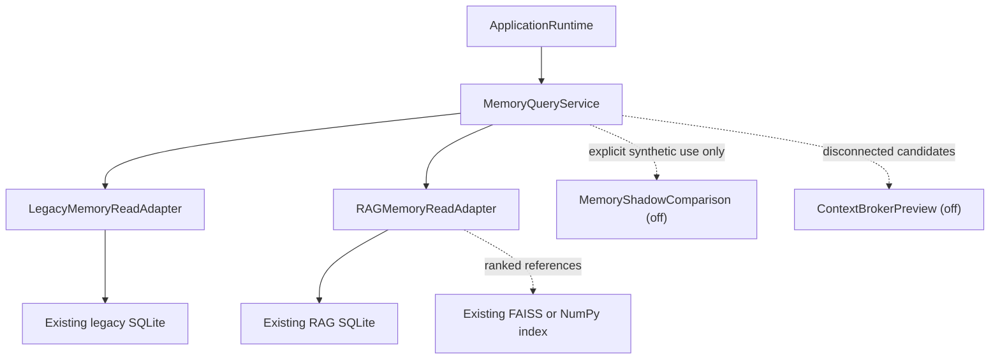

# Memory Stage 1 Read Boundary

Status: implemented, read-only, and not authoritative.

## Purpose

Stage 1 gives future application code one normalized view over the existing
legacy and RAG memory stores. It does not replace current retrieval, memory
commands, the Memory Viewer, provider context, or any write path.

No new database or table is created. `ApplicationServices` receives the query
service only after `FibiCore` has created its existing compatibility RAG owner.
The adapters retain references to those same runtime objects; they do not open
a second repository or vector-index owner.

## Contract And Model

`MemoryQueryService` exposes only `get`, `query`, `list`, `health`,
`available_sources`, and `build_candidates`. It has no remember, update,
delete, approve, import, migrate, merge, or rebuild operation.

`MemoryRecordView` is immutable. It preserves the source (`legacy` or `rag`)
and original source record ID instead of inventing a persisted universal ID.
Unavailable values remain `None`. Provenance is a bounded, immutable scalar
mapping and cannot contain database handles, engine instances, or paths.

The normalized category set is intentionally narrow: fact, preference,
project, summary, and unknown legacy. Companion state, operational audits,
notes, permissions, and temporary conversation are not registered as sources
or categories.

## Physical Read-Only Behavior

Both adapters use SQLite URI reads with `mode=ro`, `immutable=1`, and
`PRAGMA query_only`. This prevents Stage 1 reads from creating WAL/SHM files or
changing access counters. Every request opens a short-lived snapshot; records
committed after that connection opens appear on the next request.

The RAG adapter treats SQLite rows as records and the existing vector index as
ranked references. If vector search fails, lexical SQLite candidates remain
available and the result includes a content-free `semantic_unavailable`
degraded failure. Health reads do not call the existing index rebuild method.

## Privacy

The adapters fail closed for secret-shaped content, prohibited/restricted
records, deleted/expired records, rejected/revoked records, and sensitive
records without approval. The service reports source failures and duplicate
candidate references without logging content or merging records.

Duplicate candidates remain separate because Stage 1 has no authority to
choose an owner, resolve contradictions, alter IDs, or rewrite consent.

## Production Isolation

Current Core retrieval does not call `MemoryQueryService`. The Context Broker
preview is disabled and disconnected from Gemini and Ollama. Normal startup
does not run shadow comparison. Consequently, Stage 1 changes no generated
reply, provider request, Memory Viewer result, memory command, or persisted
memory.

## Removal And Rollback

To remove Stage 1, delete the three Stage 1 fields from `ApplicationServices`,
remove `_attach_memory_read_boundary` from the composition root, and remove the
new `fibi.memory` read modules. No data rollback or index rebuild is required
because Stage 1 creates and mutates no persistent data.

## Stage 2 Gate

Stage 2 remains blocked until the full regression suite proves stable source
provenance, deleted/sensitive exclusion, deterministic synthetic metrics, no
startup comparison, no provider context change, and one runtime-owned instance
across the Pet and Control Center. Backup, restore, transactional conflict
handling, and user-reviewed migration remain separate requirements before any
write migration.
