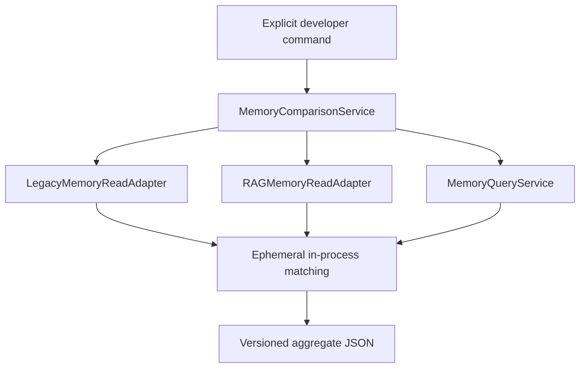

# Memory Stage 2 Content-Free Comparison

Status: implemented for explicit synthetic evaluation only.

## Architecture



`MemoryComparisonService` extends the Stage 1 shadow foundation. It is injected
with read adapters and a query service and is not constructed by application
composition, startup, Core, provider generation, Memory Viewer, or ordinary
memory recall. It has no background schedule, telemetry, UI, TTS, provider, or
write dependency.

Run the fictional suite explicitly from the repository root:

```powershell
python -m fibi.tools.memory_compare --synthetic --no-save
```

The compatibility command `python tools/run_memory_shadow_fixture.py` delegates
to the same suite. JSON is written to stdout only. No report is persisted.

## Contracts

Requests and reports are frozen dataclasses. Requests bound top-K to 25 and
timeouts to 10 seconds. Raw query text is excluded from request representation
and is never copied into a report. Reports carry schema version, opaque or
synthetic comparison ID, source health, aggregate distributions, metadata gaps,
privacy/lifecycle exclusions, overlap/ranking/duplicate metrics, latency,
normalized error categories, and interpretive finding class.

Report contracts contain no content, query, source record ID, path, database
name, prompt, embedding, fingerprint, stable content hash, or exception field.

## Ephemeral Matching

For exact overlap, content is normalized in memory and fingerprinted with HMAC
SHA-256 under a random per-comparison key. The key and fingerprints are never
serialized, logged, written to a store, or retained after the call. Exact
overlap and duplicate pair counts are aggregate only.

Likely paraphrases use an interpretable in-memory token-set overlap heuristic.
The synthetic contradiction metric uses fictional fixture labels and is not
available as an inference over local user data. These mechanisms do not merge,
discard, rewrite, or assign authority to records.

## Metrics

- Source availability, health, failure category, timeout, optional-index state,
  backend, candidate count, category/consent/sensitivity distributions, and
  latency.
- Missing consent, sensitivity, timestamp, provenance, importance, and
  confidence metadata.
- Deleted, expired, revoked, sensitive, prohibited, and secret-bearing
  exclusions when the source explicitly supports complete observation.
- Overlap@K, Jaccard overlap, normalized retention, source-exclusive counts,
  rank agreement, reciprocal-rank agreement, top-result agreement, and
  deterministic tie ordering.
- Exact duplicates, cross-source duplicates, likely paraphrase pairs, synthetic
  contradiction pairs, and labeled fictional irrelevant candidates.

No composite "memory quality score" is calculated. Individual metrics remain
visible and interpretable.

## Timeout And Errors

An explicitly invoked call executes each source in one bounded temporary
worker. Timeout returns a normalized `source_timeout` and excludes unfinished
payloads from the report. Python cannot forcibly terminate a running extension
call, so the current local-data mode remains blocked rather than weakening the
read-only guarantee. Raw exception text is discarded.

## Local-Data Mode

Local-data comparison is intentionally not implemented. Both of these commands
refuse safely:

```powershell
python -m fibi.tools.memory_compare --local-data --no-save
python -m fibi.tools.memory_compare --local-data --confirm-local-read --no-save
```

The first requires confirmation; the second reports
`local_data_mode_not_implemented`. This is deliberate: Fibi cannot yet attest
byte stability for every deletion ledger, export, cache, and auxiliary runtime
file while the application may be active. No runtime path is resolved and no
local memory is opened by either refusal.

## Removal

Remove the Stage 2 comparison models, dataset loader, CLI, synthetic dataset,
and Stage 2 tests. Remove `MemoryComparisonService` from the shadow module while
retaining the Stage 1 compatibility wrapper if still needed. No data rollback
is required because Stage 2 creates no persistent data.
