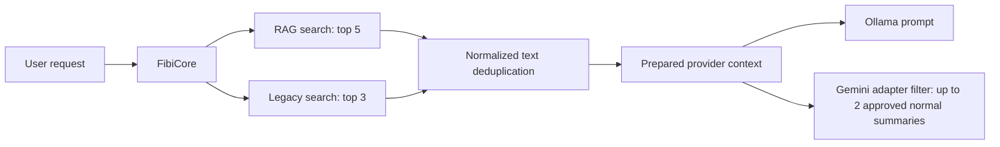
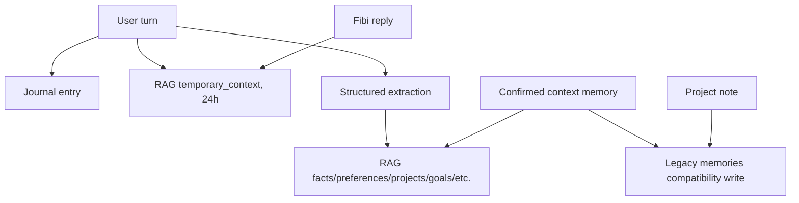

# Fibi Memory System Audit

Status: completed design audit at base `67fc54c2c783dbd2aa97c473e670c02b9ef3e7ca`

## Scope And Safety

This audit maps Fibi's persistent and transient continuity systems without
changing their schemas, routing, or user data. The live data directory was
inspected structurally with SQLite read-only mode and file metadata. Memory
values, exports, logs, prompts, and browser content were not read or printed.

The audit found four overlapping memory paths: legacy memories, RAG memories,
structured extraction, and journal/context history. They share some concepts
but do not share one lifecycle. The current product therefore cannot guarantee
that edit, export, or delete in one surface affects every representation.

## Skill Guidance Applied

- NVIDIA `rag-blueprint`: treat the primary store as transparent and durable;
  indexes must be rebuildable and operationally observable.
- NVIDIA `rag-eval`: characterize retrieval with a checked-in corpus, expected
  relevance, negative cases, Recall@K, MRR, Precision@K, and latency.
- NVIDIA `nemo-retriever`: preserve provenance and separate ingestion,
  retrieval, and generation. Its CLI is not installed and Fibi is not a NeMo
  deployment, so no NVIDIA service was called or represented as integrated.

## Structural Snapshot

The local database was opened with `mode=ro` and `PRAGMA query_only`. Counts are
included to support the architecture decision; contents are intentionally
omitted.

| Table | Rows observed | Logical owner today |
| --- | ---: | --- |
| `memories` | 17 | Legacy `MemoryEngine` and `MemoryCareEngine` |
| `conversations` | 36 | Legacy `MemoryEngine` |
| `journal_entries` | 1015 | `JournalEngine` |
| `daily_summaries` | 14 | `JournalEngine` |
| `preferences` | 2 | `PreferenceEngine` |
| `project_affinity` | 0 | `PatternEngine` |
| `opinions` | 0 | `OpinionEngine` |
| `inner_life_entries` | 37 | `InnerLifeEngine` |
| `fibi_dreams` | 1 | `InnerLifeEngine` |
| `rag_memories` | 11 | `RAGMemoryRepository` and `RAGMemoryService` |
| `rag_memory_events` | 13 | `RAGMemoryRepository` |
| `rag_documents` | 0 | RAG ingestion |
| `rag_document_chunks` | 0 | RAG ingestion |

All listed tables currently share `data/fibi_memory.db`. Co-location does not
make them one model: each engine owns different schema, retention, and user
controls. Runtime data is ignored by Git and no data file is tracked.

## Complete Store Inventory

### Database Stores

| System | Module and storage model | Producers and consumers | Retention and user control | Protection, startup, status, overlap, risk |
| --- | --- | --- | --- | --- |
| Legacy memory | `fibi.engines.memory_engine`; `memories` and `conversations` in `data/fibi_memory.db` | Core, legacy notebook, memory care, context confirmation, project notes | Indefinite; list/search/edit/hard-delete/export/import/reset exist through legacy surfaces | Local, unencrypted SQLite; low startup; active compatibility path. Overlaps RAG facts/projects. High migration and hidden-copy risk. |
| RAG memory | `fibi.rag.repository`, `service`, `rag_memory_service`; `rag_memories` and `rag_memory_events` | Core retrieval, structured extraction, Memory Review, migration helper | Soft deletion and optional expiry; review/edit/delete/export exist in RAG surface | Local SQLite plus mandatory-at-start FAISS service; active experimental path. Overlaps legacy memory and temporary context. High ownership risk. |
| Document memory | `fibi.rag.ingestion`; `rag_documents` and `rag_document_chunks` | Explicit ingestion and RAG retrieval | Source hash supports replacement; no complete product retention/delete UX | Local, unencrypted; creates embeddings/index entries. Experimental and currently empty. High privacy risk without ingestion exclusions. |
| Conversation journal | `fibi.engines.journal_engine`; `journal_entries`, `daily_summaries` | Core records user turns; summary and pattern consumers | Journal turns and summaries are effectively indefinite; legacy care can clear/export them | Local, unencrypted; low startup. Active and not presented as approved memory. High retention and duplication risk. |
| Derived preferences and affinity | `preference_engine`, `pattern_engine`; `preferences`, `project_affinity` | Pattern extraction and personality/context consumers | No explicit per-record expiry; legacy reset clears them | Local, unencrypted; low startup. Active companion state that can overlap user preferences and projects. Medium ownership risk. |
| Companion opinions | `opinion_engine`; `opinions` | Opinion formation and personality | Indefinite unless broad reset | Local, unencrypted; low startup. Active experimental companion state. Must not be exported as user facts. |
| Inner life | `inner_life_engine`; `inner_life_entries`, `fibi_dreams` | Idle/relationship behavior and memory care | Bounded by engine behavior but persists until clear/reset | Local, unencrypted; low startup. Active presentation state. It must never be retrieved as user-approved memory. |

### File And Runtime Stores

| System | Location and model | Purpose and owner | Retention and controls | Status and overlap risk |
| --- | --- | --- | --- | --- |
| Companion state | `data/fibi_state.json`; mixed JSON owned by life, relationship, consent, privacy, voice, and UI engines | Settings, mood, relationship presentation, last interaction, and consent flags | Persisted indefinitely; settings expose only part of it | Active. `last_user_message` is personal context mixed with configuration. Consent has duplicate booleans. High separation risk. |
| Project workspaces | `data/project_workspaces.json`; `ProjectWorkspaceEngine` | Registered roots and project notes | User-managed; no uniform export/delete with memory | Active user-created data. Project notes can also enter legacy/RAG memory. Medium duplication risk. |
| Work sessions | `data/work_sessions.json`; `WorkSessionEngine` | Supervised session state and summaries | User/runtime managed | Active user-created/task state. Must stay outside conversational memory unless explicitly summarized. |
| Browser notes and sessions | `data/browser/*.jsonl`; `BrowserHelperEngine` | Explicit notes and local browsing session records | File-based; separate controls | Active/experimental. Raw browsing context must not enter memory implicitly. High privacy risk. |
| Workflow state and runs | `data/workflows/*`; `WorkflowRecipeEngine` | User recipes and task audit | File-based | Active/experimental. Operational run records are not memory. |
| Action audit | `data/action_journal.jsonl`; `ActionJournalEngine` | Permission-checked desktop action history | Append-oriented local audit | Active operational record. It must not be model context. |
| Deletion audit | `data/memory/memory_deletion_log.jsonl`; `MemoryReviewEngine` | Records RAG deletion metadata | Append-oriented; content is summarized | Active operational record. Does not coordinate legacy deletion. |
| Temporary context | `ContextEngine` in memory; RAG `temporary_context` rows with 24-hour expiry | Recent turns/current task for response continuity | In-memory context has a 90-minute TTL and max 12 entries; Core also writes each turn to RAG when learning is enabled | Active. The RAG copy blurs temporary context and long-term memory. High consent/retention risk. |
| FAISS and manifests | `data/rag/fibi_rag*`; `fibi.rag.vector_store` | Derived semantic candidates and ID mapping | Rebuilt after update/delete/expiry and on count mismatch | Active experimental derived index. This audit added a NumPy fallback so missing FAISS no longer blocks startup. Medium packaging/rebuild/corruption risk remains. |
| RAG caches | Process memory in `RAGMemoryService` | Query and context cache | TTL and cleared on mutation | Derived and non-authoritative. Low persistence risk; invalidation remains service-local. |
| Legacy exports | `data/exports/fibi_export_*.json`; `MemoryCareEngine` | Explicit broad local export | User-created files; no automatic expiry | Active legacy export. Scope differs from RAG export. High user-understanding risk. |
| RAG review exports | `data/reports/memory_export_*`; `MemoryReviewEngine` | Explicit selected/local memory export | User-created files; no automatic expiry | Active RAG export. A sensitive-export filtering defect was fixed in this audit. |
| Migration reports | `data/reports/legacy_memory_to_rag_*`; legacy migration script | Migration diagnostics | Created by script, including nominal dry run | Existing script is unsafe for real use because service initialization can write and reports are always created. Critical migration risk. |

No store provides encryption at rest. Files rely on operating-system account and
directory permissions. Backups exist only in selected legacy reset/export
flows; there is no unified, verified backup policy.

## Data Classification And Intended Ownership

| Class | Examples | Future authoritative owner | Inside MemoryService? |
| --- | --- | --- | --- |
| A. User-approved memory | Facts, preferences, project memories, selected summaries | `MemoryService` | Yes |
| B. User-created information | Notes, reminders, registered projects, saved work sessions | `NotesService`, `ReminderService`, `ProjectService`, `WorkSessionService` | No; expose references only |
| C. Companion configuration | Voice, theme, interaction settings | `CompanionStateService` | No |
| D. Companion relationship state | Bounded warmth/ritual/presentation values | `CompanionStateService` | No |
| E. Temporary context | Recent turns, selected files, current task/project | `ConversationStore` or ephemeral context service | No |
| F. Operational records | Consent, permissions, action logs, diagnostics | Permission and task audit services | No |
| G. Derived indexes | Embeddings, FAISS, caches | `SearchIndex` | No; references authoritative IDs |

The typed ownership map in `fibi.memory.policy` assigns each concrete target
record type exactly once. Architecture tests reject provider-to-repository,
UI-to-raw-storage, and index-to-authoritative-store dependencies.

## Current Read Flow

This is not provider-independent logical context. Ollama can receive the Core
memory block while Gemini reconstructs a narrower approved subset. A future
Context Broker must produce one approved logical set before either adapter is
selected.

## Current Write Flow

The confirmed-context path is a true dual write. There is no transaction across
representations, no shared record identity, and no coordinated rollback.

## Retrieval Characterization

The RAG service uses a hashing embedder by default and optionally supports
Sentence Transformers. Search combines vector and lexical candidates, then
scores semantic similarity, importance, confidence, recency, and category. The
current weights are 0.55, 0.17, 0.12, 0.08, and 0.08 respectively. Candidate
fusion is 0.72 vector and 0.28 lexical.

Findings:

- Exact facts, preferences, and project fixtures are retrievable.
- `memory_key` supports contradiction replacement and sensitive updates require
  additional approval.
- Exact hashes and vector similarity support duplicate detection.
- Soft-deleted rows are excluded and trigger an index rebuild.
- `retrieve_conversation_context` forces threshold `0.0`, so weakly relevant
  memories may enter context.
- Review approval and sensitivity live in loose metadata and are not enforced
  by base retrieval. Provider-specific filtering partially compensates only for
  Gemini.
- Lexical matching, key lookup, and some category statistics scan active rows
  in Python. This will not scale to large collections.
- The whole vector index rebuilds after update, delete, and expiry. Incremental
  add is supported; incremental replacement and deletion are not.
- Retrieval failure is generally converted to an empty context, which protects
  availability but weakens user-visible diagnostics.

The checked-in synthetic benchmark before this change reported five queries,
Recall@K `1.0`, MRR `0.9`, Precision@K `0.8`, mean query latency `16.758 ms`,
p95 `17.936 ms`, indexing `96.057 ms`, two false positives, and zero empty
results. These numbers characterize the small hashing fixture only. They do not
prove production relevance, sensitive exclusion, or large-scale behavior.

## FAISS And RAG Recommendation

Choose a staged combination of options B and C:

1. Make transparent SQLite records and deterministic metadata/keyword/FTS,
   recency, importance, and category filtering the supported 0.4 baseline.
2. Keep FAISS as an optional secondary index for experiments and larger local
   collections. It must be disposable, versioned, rebuildable, and removable
   without data loss.
3. Do not remove FAISS in this task. The new local NumPy fallback decouples
   startup from the optional package; next, characterize measurable FAISS
   benefit against the same corpus.

This recommendation matches the observed small volume, avoids Windows
packaging and AVX compatibility costs in the supported path, and preserves a
scaling option. FAISS must never become proof that a memory exists or was
deleted.

## Consent And Privacy Findings

- `MemoryConsentEngine` and `PrivacySettings.allow_memory_learning` can diverge.
  Commands update both, while the Settings surface updates the privacy setting.
- Core writes each user/reply turn as short-lived RAG context when learning is
  enabled. This is broader than explicit approved-memory policy.
- Structured extraction can create long-term records automatically.
- Review approval is metadata, not a repository invariant.
- Sensitive filtering differs by retrieval and provider path.
- `.env` and secret-bearing documents were not rejected by ingestion before
  this audit. The new ingestion policy blocks path and content before metadata,
  chunks, hashes, or embeddings are persisted.
- The RAG export path allowed sensitive inclusion too broadly. It now excludes
  prohibited content always and requires both explicit sensitive opt-in and an
  approved review state.
- Delete is internally consistent within RAG primary rows and its FAISS index,
  but does not remove equivalent legacy, journal, summary, or export copies.
- Existing logs generally use IDs/categories rather than content. Persistent
  journals and explicit exports contain user text and need clearer retention.

## Viewer And Command Findings

Fibi has two memory-management families:

- Legacy notebook/care supports list, search, inspect, edit, hard delete,
  category clear, broad export/import, reset, journal/dream/preference clearing,
  and `/forget` compatibility flows.
- RAG review supports list, semantic search, inspect, approve, pin, archive,
  edit, soft delete, category delete, export, health, and `/memory` commands.

The desired command family already mostly exists: remember, recall/list,
recent, forget, stats, and export. Adding synonyms now would deepen ambiguity.
The migration should normalize these commands only after every displayed row
has one authoritative ID and deletion can attest to primary, derived, and
legacy-copy disposition.

## Highest-Risk Defects

1. Critical: the existing legacy-to-RAG dry run can initialize/write RAG files
   and always emits a report. It is not approved for real data.
2. High: deleting or editing in one memory UI can leave an undisclosed copy in
   another store.
3. High: provider paths receive different approved logical context.
4. High: consent and memory-learning booleans can diverge.
5. High: automatic journal and extraction writes exceed a simple explicit
   approved-memory mental model.
6. Medium: FAISS is operationally coupled to RAG startup and rebuilds broadly.
7. Medium: retention for journals, summaries, exports, and state text is vague.
8. Medium: one SQLite file contains unrelated ownership domains without one
   schema migration authority.

## Safe Changes In This Audit

- Added typed target categories, consent, sensitivity, status, data classes,
  ownership rules, and a provider-neutral target record.
- Added a structural read-only inventory and deliberately blocked migration
  preflight.
- Added lightweight AST ownership guards.
- Added a local NumPy vector fallback so missing FAISS acceleration does not
  prevent Fibi startup or SQLite-backed memory use.
- Blocked secret-like ingestion paths and secret-bearing document content.
- Corrected RAG export filtering for prohibited and sensitive records.
- Replaced personal-looking checked-in evaluation fixtures with synthetic
  identities and projects.

No runtime store, schema, record, index, export, backup, or provider context was
migrated or deleted.

## Audit Conclusion

Fibi has useful memory components but no single product memory authority. The
next implementation phase is Stage 1: define an injected read-only
`MemoryService` contract and compatibility adapters, then compare results using
synthetic fixtures. Write cutover, real import, legacy retirement, and UI
normalization remain explicitly out of scope until backup, transaction,
rollback, conflict, and deletion guarantees are implemented.
