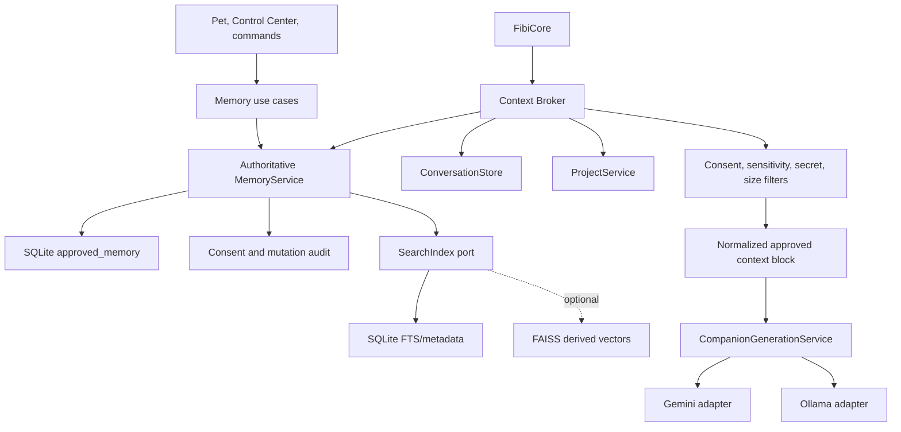
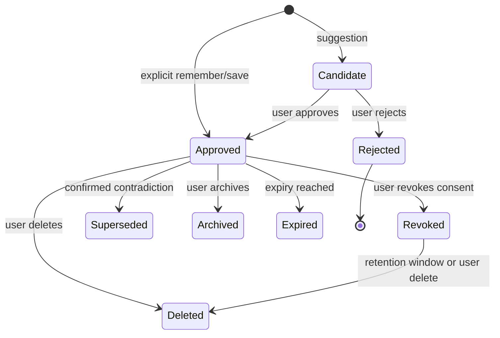
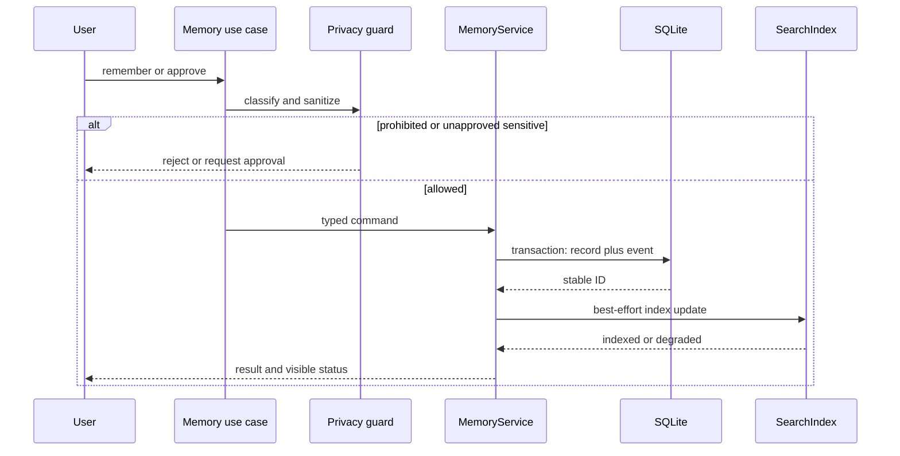

# Memory Target Architecture

Status: proposed for staged delivery; no production cutover has occurred.

## Design Goals

Fibi's product memory must be local-first, provider-independent, visible,
editable, deletable, exportable, consent-aware, and resilient to index or model
replacement. Presence and continuity do not require retaining every turn.

The architecture deliberately separates approved memory from notes, projects,
temporary conversation, companion presentation state, audits, and search
indexes.

## Service Map

Only `MemoryService` creates or mutates long-term approved memory. UI and Core
call typed use cases. Provider adapters receive prepared context and cannot
access repositories. The index stores authoritative record IDs and can be
destroyed and rebuilt.

## Data Ownership

| Data | Authoritative owner | Persistence |
| --- | --- | --- |
| Approved facts, preferences, project memories, selected summaries | `MemoryService` | SQLite |
| Explicit notes | `NotesService` | Separate transparent store |
| Reminders | `ReminderService` | Separate transparent store |
| Registered projects and project notes | `ProjectService` | Project repository |
| Current/recent conversation | `ConversationStore` | Bounded retention |
| Companion settings and bounded relationship presentation | `CompanionStateService` | Versioned settings/state |
| Consent and permission history | `PermissionAuditService` | Append-safe audit |
| Desktop/task events | `TaskAuditService` | Bounded audit |
| Embeddings, FAISS IDs, FTS rows, query caches | `SearchIndex` | Derived/rebuildable |

The code-level proposal is represented by `fibi.memory.policy`. It is a target
contract, not a replacement for current runtime models.

## Authoritative Record

The first schema supports exactly four categories: `FACT`, `PREFERENCE`,
`PROJECT`, and `SUMMARY`.

| Field | Required | User visible | Editable | Rule |
| --- | --- | --- | --- | --- |
| `id` | Yes | Yes | No | Stable local integer identifier |
| `category` | Yes | Yes | Yes | One of four typed categories |
| `content` | Yes | Yes | Yes | Non-empty, bounded text |
| `subject_key` | When applicable | Optional advanced view | Indirectly | Normalized contradiction/merge key |
| `importance` | Yes | Yes | Yes | `0.0..1.0` |
| `confidence` | Yes | Yes | Yes | `0.0..1.0`; provenance confidence, not truth |
| `source` | Yes | Yes | No | Explicit command, viewer, confirmed suggestion, migration source |
| `consent_status` | Yes | Yes | Via approve/reject/revoke | Candidate, approved, rejected, revoked |
| `created_at` | Yes | Yes | No | UTC timestamp |
| `updated_at` | Yes | Yes | No | UTC timestamp |
| `last_used_at` | No | Yes | No | Updated after successful context selection |
| `expires_at` | No | Yes | Yes | Required for temporary-like approved summaries if used |
| `sensitivity` | Yes | Yes | Via review | Normal, sensitive, restricted, prohibited |
| `status` | Yes | Yes | Via lifecycle action | Active, superseded, archived, deleted, expired |
| `supersedes_id` | No | Yes | No | Links contradiction history |
| `metadata` | No | Advanced view | Strict use case only | At most 16 scalar fields, keys at most 64 characters |

### Invariants

- Only approved, active, normal-sensitivity records are eligible for ordinary
  model context.
- Prohibited content is rejected before persistence.
- Sensitive and restricted records require explicit review and are excluded
  from cloud context by default.
- A content hash is an optimization, not identity or consent.
- Every mutation records content-free audit metadata and happens in one SQLite
  transaction with its provenance/event record.
- Deleting a record commits the primary tombstone first, invalidates caches,
  and removes/rebuilds derived index entries. Index failure cannot resurrect it.

## Duplicate And Contradiction Policy

1. Normalize category, subject key, and text for candidate comparison.
2. Exact normalized content under the same category becomes one record with
   merged provenance and the strongest approved importance/confidence.
3. A high-similarity paraphrase is presented as a possible duplicate; automatic
   merge is allowed only for normal, approved, same-subject records under a
   conservative tested threshold.
4. A different value for the same subject key is a contradiction, not a
   duplicate. The new approved record supersedes the prior active record while
   preserving both and linking `supersedes_id`.
5. Sensitive contradictions never overwrite silently. They require explicit
   confirmation and remain visible in audit/history.

## Consent Lifecycle

Explicit `remember` and Memory Viewer saves may create an approved record after
secret and sensitivity checks. An inferred useful item starts as a visible
candidate. Disabled memory creates neither candidate nor approved memory.

Never save credentials, tokens, private keys, cookies, recovery codes, raw
`.env`, full private files, entire conversations by default, or unrelated
project/browser secrets. Health, financial, intimate, or similarly sensitive
content requires explicit case-specific approval.

## Context Broker

The Context Broker is a narrow use case, not a generic cognitive framework.
It accepts:

- normalized user request and intent/category hints;
- current project/task IDs selected by the user;
- bounded recent conversation references;
- a provider-neutral privacy policy and byte/token budget.

It performs:

1. deterministic metadata/category filtering;
2. keyword/FTS retrieval and optional semantic candidate retrieval;
3. score fusion using relevance, recency, importance, and category fit;
4. consent/status/sensitivity enforcement;
5. duplicate/contradiction resolution;
6. secret sanitization and hard item/byte/token limits;
7. normalized summaries plus IDs/provenance for generation;
8. content-free retrieval diagnostics and `last_used_at` updates only after use.

It returns immutable items shaped as `{id, category, summary, source,
confidence}` plus safe diagnostics. It never returns database handles,
embeddings, raw project files, audits, or companion inner-life records.

### Acceptance Criteria

- An empty or failed store returns an empty context and a safe diagnostic; chat
  still runs.
- A selected project can contribute only approved project memory and explicitly
  authorized project context.
- Relevant approved preferences, facts, and one selected summary fit the
  configured budget.
- Sensitive, unapproved, deleted, expired, rejected, and revoked records are
  excluded before provider selection.
- Gemini and Ollama receive the same logical context item IDs for the same
  request and policy. Only transport formatting may differ.
- Switching or replacing a provider cannot mutate or invalidate memory.

## Retrieval Strategy

For the supported baseline, query SQLite with indexed category/status/key/time
columns and FTS5/keyword candidates. Rank with deterministic weights and stable
tie-breaking by record ID. For larger collections, merge optional FAISS
candidates by authoritative ID. Record the embedding implementation, dimension,
normalization, and index schema version in a manifest.

If FAISS is missing, incompatible, or corrupt, mark semantic acceleration
unavailable, discard/rebuild only derived files, and continue with SQLite. Do
not block startup or memory review.

## Memory Lifecycle

## Index Lifecycle

1. Read authoritative active IDs and index manifest.
2. If versions and checksums match, load the secondary index.
3. On add/update/delete, commit SQLite first and enqueue an idempotent index
   event.
4. Apply incremental operations where supported.
5. On mismatch or corruption, quarantine the derived files and rebuild from
   approved active records.
6. Atomically replace the completed index and update its manifest.
7. Expose degraded health without blocking primary memory operations.

## API Stability

The target memory contract is `0.4-experimental`. During Stages 1 through 3 it
is read-only or compatibility-backed. It becomes the sole write authority only
after migration, deletion, consent, context equivalence, and rollback gates
pass. No plugin stability is promised before a later ADR.

## Explicit Non-Goals

- No Sovereign Brain, Interpreter Brain, autobiographical cognition, identity,
  belief, or consciousness architecture.
- No silent migration or destructive schema conversion.
- No provider-owned memory policy.
- No cloud database, telemetry, or remote indexing.
- No claim that companion presentation state is a user fact.
