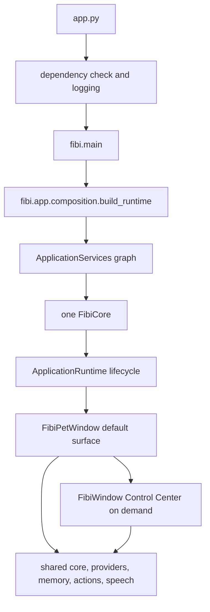

# Fibi Companion Overengineering Audit

Date: 2026-07-30

Audited revision: `c00a97d`

Scope: shipping code, tests, tools, packaging, documentation, and protected
unstaged wake-runtime work

## Executive Summary

Fibi is a modular Windows desktop application with a valuable product core: a
small Pet, concise chat, manually selected Gemini or Ollama, user-reviewed
memory, push-to-talk, optional speech, registered-project help, and safe native
actions. The permission boundary, runtime lifecycle, provider-neutral result
types, and Pet/Control Center service sharing are necessary complexity and
should remain.

The principal maintenance problem is not the number of features alone. It is
that migration layers coexist with their replacements and are still connected
through one 4,883-line orchestrator. `FibiCore` owns routing, commands, memory
policy, provider compatibility, actions, project workflows, voice policy,
diagnostics, and response presentation. Memory has two retrieval paths and
several domain-specific writers. Provider generation has a new authoritative
service but still constructs and mirrors a legacy router. Multiple engines
independently update the same JSON state file. The Pet reuses the right backend
but inherits the full Control Center implementation.

The recommended response is staged consolidation, not a rewrite. First remove
measured startup coupling and document inactive modules. Next establish one
authoritative provider, memory, settings, and UI-state path. Keep wake word,
RVC, broad workflows, and future backends behind explicit experimental
boundaries. Remove compatibility modules only after caller and migration tests
prove they are no longer needed.

## Method And Runtime Trace

The audit used tracked-file inventory, AST measurements, import/reference
searches, constructor and call-site tracing, isolated import timing, tests, and
the current composition/runtime diagnostics. Filenames alone were not treated
as evidence of use.

The shipping startup path is:

`ApplicationRuntime` owns start and shutdown. The Pet and Control Center share
one Core and one composed service graph. Model text cannot directly execute an
action: direct user text is detected, permission-checked, confirmed when
needed, and then sent to `DesktopActionEngine`.

## Complexity Measurements

These values describe the audited working tree. The untracked experimental
`wake_word_controller.py` is included in source measurements and is identified
separately wherever it changes a conclusion.

| Measure | Result | Interpretation |
|---|---:|---|
| Product Python | 188 files, 30,038 lines | Broad modular monolith; line count is context, not proof. |
| Test Python | 108 files, 10,149 lines | Strong coverage, with substantial historical compatibility cost. |
| `FibiCore` | 4,883 lines, 168 methods | Excessive orchestration and policy concentration. |
| `FibiCore.__init__` | 59 dependencies, 329 lines, 125 assigned attributes | Composition was extracted, but Core's contract remains too wide. |
| `FibiCore.respond` | 435 lines, 78 branch nodes | Route precedence has high regression risk. |
| Slash command handler | 300 lines, 117 branch nodes | Command ownership remains centralized. |
| `fibi_window.py` | 2,134 lines | Pet-compatible widgets, dialogs, workers, settings, and Control Center coexist. |
| `FibiWindow` | 953 lines, 52 methods | Shared UI behavior is useful but too inheritance-heavy. |
| `FibiSettingsDialog` | 576 lines | One dialog owns several unrelated product settings. |
| Shared engine types | 1,496 lines | Stable values are useful; unrelated domains share one change surface. |
| Core imports | 126 import statements | Core depends directly on almost every capability family. |
| Composition imports | 65 import statements | Mostly justified concrete wiring at the application boundary. |
| Engine package exports | 27 eager imports | A lightweight submodule import loaded 118 engine modules. |
| Isolated lightweight import | 3,887.9 ms before the safe fix | Eager package initialization imposed measurable startup/test cost. |
| Same import after lazy exports | 290.8 ms and 5 engine modules | One-run probe improved 92.5%; Core and inactive adapters stayed unloaded. |
| Direct Core attribute replacements in tests | 65 across 19 files | Tests reach through orchestration internals instead of stable capability seams. |
| Runtime `print` calls | 142 total; 51 in Core | User console output and developer diagnostics are mixed. |
| Structured logger calls | 92 | Logging migration is incomplete rather than absent. |

Largest classes after Core are `FibiWindow` (953 lines), `LifeEngine` (585),
`FibiSettingsDialog` (576), `GeminiProvider` (496), the protected experimental
`WakeWordController` (440), `RAGMemoryRepository` (436), and
`MemoryCareEngine` (367). Large size alone is not a removal reason; the risk is
where size combines with many responsibilities or duplicate authority.

## Necessary Complexity

### Keep the runtime and composition boundary

`fibi/app/composition.py`, `contracts.py`, and `runtime.py` explicitly construct
one graph, expose small structural protocols, detect duplicate service
instances, and make shutdown idempotent. Their import fan-out is expected at a
composition root. A dependency-injection framework would add cost without
improving this graph.

### Keep action safety

`action_intent_detector.py`, `permission_engine.py`,
`action_confirmation_engine.py`, `action_allowlists.py`, and
`desktop_action_engine.py` separate user intent, policy, confirmation, and side
effects. Opening an app remains deterministic and does not require an agent
planner. This is security-relevant complexity with direct user value.

### Keep manual provider selection

`fibi/services/providers/` has one registry, a persisted manual selection
service, normalized results, safe diagnostics, and explicit opt-in fallback.
The selected provider does not silently change after failure. These rules are
part of Fibi's product contract.

### Keep one shared Pet and Control Center backend

`FibiPetWindow` opens the Control Center with the same Core, life state, and
services. The runtime identity diagnostic verifies this. The implementation
inheritance should eventually be reduced, but service sharing must not be
lost.

### Keep local privacy and explicit consent

Secrets are loaded at the application boundary, raw microphone audio is not
retained, project paths are registered, memory has consent checks, and model
output cannot grant itself action permission. Consolidation must preserve each
of these boundaries.

## Accidental Complexity

- Core is both coordinator and implementation home for commands, route order,
  provider status, memory review, project tasks, voice, and response logging.
- `fibi.engines.__init__` eagerly imported 27 modules for two UI imports of
  `FibiCore`, forcing unrelated submodule imports through the full graph.
- `fibi_state.json` is independently read, merged, and written by life,
  privacy, actions, voice, relationship, boundary, model health, consent, and
  confirmation engines. This duplicates code and risks lost updates.
- The Pet inherits the full Control Center class and imports its dialogs and
  worker behavior even when the Center never opens.
- UI request, TTS, voice, warmup, wake, and optional indexing work use several
  unrelated raw thread/timer ownership patterns.
- Console diagnostics use both `print` and `logging`, so normal runtime output
  is noisy and difficult to filter.

## Temporary Migration Complexity

- `CompanionGenerationService` is the active generation path, while
  `ModelRouter` is still constructed, mode-synchronized, and populated with
  mirrored result fields. No production call site invokes `ModelRouter.route`.
- Core uses `RAGMemoryServiceFacade` through `MemoryRouter`, but also writes and
  retrieves through legacy `MemoryEngine`; `_related_memories` combines both.
- `LegacyMemoryAdapter` exists to route old calls to RAG but has no production
  caller; only a decomposition smoke test exercises it.
- `fibi/life/life_engine.py` and `fibi/voice/listen.py` are compatibility
  imports. They are small, active or plausible public imports and should have a
  documented deprecation window rather than immediate removal.
- Direct `FibiCore(...)` construction remains supported while composition-root
  adoption settles. This is acceptable temporarily, but fallback construction
  keeps its 59-argument contract and duplicate construction branches alive.

## Speculative Complexity

- `BackgroundIndexingQueue` has no production caller. It is tested RAG
  infrastructure for document ingestion, not a current startup worker.
- `WorkerManager` wraps `ThreadPoolExecutor` but has no production or test
  instantiation.
- NVIDIA and generic OpenAI-compatible model adapters are constructed or
  exported despite the supported release path being Gemini and Ollama.
- Plugin documentation describes a future boundary; there is no shipping
  plugin loader. It should remain a design draft, not an implied capability.
- Advanced patch, check, workflow, browser-research, inner-life, dream,
  opinion, ritual, and relationship systems have partial tests but collectively
  exceed the daily-companion 0.4 scope. Useful pieces should remain available
  as Labs capabilities without driving default startup or settings complexity.
- Wake word and RVC are valuable experiments but environment-sensitive. Both
  should stay off by default and lazily load optional dependencies.

## Top Ten Findings

### 1. FibiCore is the dominant change-risk surface - SIMPLIFY

- **Files:** `fibi/engines/core.py`, `fibi/app/composition.py`,
  `fibi/engines/routers/`.
- **Current responsibility:** Core coordinates nearly every use case and also
  owns most command handlers, route policy, compatibility state, and copy.
- **Evidence:** 4,883 lines, 168 methods, 59 constructor dependencies; `respond`
  has 78 branch nodes; 65 direct Core attribute replacements occur in tests.
- **User impact:** route precedence regressions can affect chat, actions,
  memory, and provider behavior at once.
- **Maintainer impact:** unrelated features conflict in one file and tests must
  know private fields.
- **Risk of change:** high.
- **Action:** extract three cohesive use-case coordinators in order: command
  handling, generation/context preparation, then action orchestration. Do not
  create one class per command.
- **Effort:** large, 3 to 5 focused pull requests.
- **Tests:** route-characterization matrix, command snapshots, provider/action
  contract tests, full GUI smoke.
- **Rollback:** keep Core methods as delegating facades for one release; revert
  each coordinator independently.

### 2. User memory has two authoritative retrieval paths - CONSOLIDATE

- **Files:** `memory_engine.py`, `memory_care_engine.py`,
  `structured_memory_engine.py`, `memory_review_engine.py`, `memory_router.py`,
  `fibi/rag/`, journal/pattern/habit engines.
- **Current responsibility:** legacy conversations/facts and RAG records share
  one SQLite file but use different tables, repositories, ranking, and review
  behavior.
- **Evidence:** Core constructs both stores, writes to each in different flows,
  and `_related_memories` retrieves five RAG and three legacy matches.
- **User impact:** recall, edit, forget, and duplicate behavior are hard to
  predict or explain.
- **Maintainer impact:** migrations and consent changes must cover multiple
  APIs and schemas.
- **Risk of change:** very high because personal data is involved.
- **Action:** define RAG facade as the primary user-facing memory service,
  migrate supported legacy rows with provenance, and keep journals/inner-life
  as non-user-memory event data. Never delete the legacy tables during the
  first migration.
- **Effort:** large.
- **Tests:** migration copies, idempotency, consent, update/delete, recall
  parity, export, rollback, corrupt-index recovery.
- **Rollback:** dual-read with comparison metrics, immutable database backup,
  feature flag returning reads to legacy until parity is proven.

### 3. Provider migration retains duplicate policy and health state - CONSOLIDATE

- **Files:** `fibi/services/providers/`, `model_router.py`,
  `model_health_engine.py`, `model_engine.py`, `nvidia_model_engine.py`,
  `openai_compatible_provider.py`, composition and Core provider handlers.
- **Current responsibility:** the new service selects and generates; the legacy
  router still mirrors selection, fallback, latency, retry, and error fields.
- **Evidence:** production generation calls `generation_service.generate`;
  `ModelRouter.route` is referenced by tests but not production call sites.
- **User impact:** status can drift and fallback rules are harder to trust.
- **Maintainer impact:** provider changes require two state models and legacy
  test setup.
- **Risk of change:** medium-high.
- **Action:** make provider services the only policy authority, change status
  views to `ProviderDiagnostics`, then deprecate `ModelRouter.route` and mirrored
  fields. Keep Gemini/Ollama adapters; move unsupported adapters behind Labs.
- **Effort:** medium.
- **Tests:** manual selection persistence, no silent switching, fallback-off,
  timeout/error categories, status snapshots, legacy deprecation behavior.
- **Rollback:** retain a read-only compatibility facade for one release.

### 4. Settings share files without one persistence owner - CONSOLIDATE

- **Files:** `life_engine.py`, `app_settings_engine.py`,
  `privacy_settings_engine.py`, `action_settings_engine.py`,
  `voice_settings_engine.py`, `voice_skin_settings_engine.py`, boundary,
  relationship, consent, health, and confirmation engines; `settings.py`.
- **Current responsibility:** domain engines persist separate sections, many in
  `fibi_state.json`; environment/config modules also expose provider constants.
- **Evidence:** at least eight engines independently read and rewrite the same
  state file, while app and voice-skin settings use separate JSON files.
- **User impact:** a failed or concurrent update can lose another setting.
- **Maintainer impact:** precedence, schema version, atomicity, and corruption
  recovery are repeated.
- **Risk of change:** medium-high.
- **Action:** introduce one atomic namespaced state repository with schema
  versioning, then keep domain settings services as typed policy facades. Do not
  replace them with one giant settings class.
- **Effort:** medium-large.
- **Tests:** concurrent/partial writes, migration, unknown-key preservation,
  first-run defaults, packaged paths, corrupt JSON recovery.
- **Rollback:** retain original files and support read-old/write-new for one
  version.

### 5. Engine package imports the application graph eagerly - SIMPLIFY

- **Files:** `fibi/engines/__init__.py`, Pet and Control Center imports.
- **Current responsibility:** convenience re-exports for 27 engine classes.
- **Evidence:** importing `action_confirmation_engine` loaded 118 engine modules,
  including Core and inactive provider adapters, in 3,887.9 ms.
- **User impact:** slower startup and higher chance an unavailable optional
  dependency breaks an unrelated feature.
- **Maintainer impact:** isolated tests import much more state than requested.
- **Risk of change:** low when public names are preserved.
- **Action:** use PEP 562 lazy exports and cache resolved attributes.
- **Effort:** small; implemented with an isolated subprocess regression test.
- **Tests:** lightweight import excludes Core/legacy adapters; every public
  export still resolves.
- **Rollback:** revert the initializer and its focused test.

### 6. Pet reuse is implemented through heavyweight inheritance - SIMPLIFY

- **Files:** `fibi/ui/fibi_pet_window.py`, `fibi/ui/fibi_window.py`.
- **Current responsibility:** Pet subclasses the 953-line Control Center window
  to reuse message, voice, drag, and settings behavior.
- **Evidence:** Pet overrides construction and several no-op status methods but
  imports all Control Center dialogs and handlers at startup.
- **User impact:** Pet changes can cause broad UI regressions; import and memory
  cost is larger than its 200x220 surface suggests.
- **Maintainer impact:** inheritance makes valid Pet state hard to see.
- **Risk of change:** medium-high due Qt lifecycle and protected wake work.
- **Action:** extract one shared `CompanionPresenter` or narrow interaction
  controller, then make Pet and Center sibling views. Keep the same Core and
  service instances.
- **Effort:** medium-large.
- **Tests:** window size/flags/drag, menu, shared service identity, Center
  opening, message/voice flows, screenshots and GUI smoke.
- **Rollback:** keep the inherited implementation until sibling views pass the
  same contract suite.

### 7. Background task ownership is fragmented - CONSOLIDATE

- **Files:** UI response/TTS/voice workers, `warmup_engine.py`, protected
  `wake_word_controller.py`, `rag/ingestion.py`, `worker_manager.py`, runtime.
- **Current responsibility:** short-lived work and optional continuous work use
  raw daemon threads, timers, one unused executor wrapper, and Qt timers.
- **Evidence:** UI starts four raw thread sites; warmup starts another; wake and
  RAG each define a long-lived worker; `WorkerManager` has no callers.
- **User impact:** shutdown races and stale callbacks can appear as hangs or
  late speech.
- **Maintainer impact:** cancellation and error reporting differ per feature.
- **Risk of change:** high around audio/Qt.
- **Action:** first define a runtime-owned background-task contract for finite
  jobs; keep wake as its own opt-in lifecycle service. Do not route animation
  timers through an executor. Remove `WorkerManager` only after the replacement
  contract is in use.
- **Effort:** medium-large.
- **Tests:** shutdown during request/TTS/listen, stale completion suppression,
  worker exception reporting, no worker while features are disabled.
- **Rollback:** migrate one worker family at a time behind current UI methods.

### 8. Advanced workflows exceed the current product boundary - DEFER

- **Files:** patch/check/workflow/session/browser-research engine families and
  their command handlers in Core.
- **Current responsibility:** project edits, checks, fix suggestions, recipes,
  sessions, browser notes, and guided work.
- **Evidence:** more than twenty engine modules and several Core state fields
  support features described as experimental in the README.
- **User impact:** useful for advanced users, but adds command/settings surface
  to the default companion.
- **Maintainer impact:** broad test matrix and action-safety review before the
  daily Pet path is stable.
- **Risk of change:** medium if hidden, high if deleted.
- **Action:** keep code and data, move entry points under Labs, construct costly
  services on first use, and avoid a generic orchestration framework.
- **Effort:** medium.
- **Tests:** default startup excludes Labs workers, explicit enable/use paths,
  existing safety and rollback tests.
- **Rollback:** restore current menu/command exposure; no data migration needed.

### 9. Confirmed inactive compatibility/prototype modules remain - DEPRECATE/REMOVE

- **Files:** `fibi/brain/ai.py`, `fibi/control/apps.py`,
  `fibi/control/browser.py`, `fibi/control/keyboard.py`, `fibi/ui/window.py`,
  `worker_manager.py`, `rag_memory_engine.py`, `legacy_memory_adapter.py`.
- **Current responsibility:** old model/control helpers, a placeholder window,
  unused worker abstraction, and memory facades.
- **Evidence:** repository reference searches found no production callers for
  these modules; memory adapters are exercised only by historical tests.
- **User impact:** unsafe legacy control examples and obsolete provider behavior
  can be mistaken for supported paths.
- **Maintainer impact:** dependencies, documentation, and compatibility tests
  preserve ambiguous APIs.
- **Risk of change:** medium because external users may import undocumented
  modules.
- **Action:** mark unsafe/obsolete modules deprecated, add import telemetry only
  in development if desired, publish a removal window, then remove them and
  their historical tests. `ui/window.py` is an empty placeholder and can be the
  first removal after release-content review.
- **Effort:** small-medium.
- **Tests:** repository caller scan, import deprecation test, release manifest,
  active action/provider/memory paths.
- **Rollback:** restore standalone modules; they do not own authoritative data.

### 10. Diagnostics and architecture documents have competing authorities - SIMPLIFY

- **Files:** 142 `print` call sites, logging configuration, Core/model/voice
  diagnostics, root `ARCHITECTURE.md`, `docs/ARCHITECTURE.md`, prior audit, and
  versioned development documents.
- **Current responsibility:** user console progress, developer diagnostics,
  support status, and historical design records.
- **Evidence:** 51 Core prints and 25 legacy-router prints coexist with 92 logger
  calls; root and docs architecture files describe different migration stages.
- **User impact:** noisy consoles obscure actionable failures; stale documents
  reduce trust.
- **Maintainer impact:** logs cannot be filtered consistently and architecture
  decisions are hard to locate.
- **Risk of change:** low-medium, provided support-visible messages remain.
- **Action:** make `docs/ARCHITECTURE.md` canonical, label historical documents,
  convert structured diagnostic prints to logger calls with a user-enabled
  verbose mode, and never log prompts, responses, transcripts, or secrets.
- **Effort:** medium.
- **Tests:** caplog assertions, privacy scan, CLI/GUI smoke, documentation links.
- **Rollback:** restore individual console lines if a support workflow depends
  on them.

## Duplicate Systems

| Domain | Active or retained paths | Decision |
|---|---|---|
| User memory | Legacy `memories` plus `rag_memories`; dual retrieval in Core | Consolidate behind RAG facade after migration parity. |
| Memory-like state | journal, patterns, habits, preferences, opinions, relationship, inner life | Keep distinct event domains only where user value is clear; do not present all as user memory. |
| Provider generation | New provider services plus legacy `ModelRouter` status/policy | New services authoritative; deprecate router behavior. |
| Provider health | provider diagnostics, model health cooldown, router mirrors | Consolidate status; keep a narrow cooldown policy if still needed. |
| Settings persistence | shared state JSON writers, app JSON, voice-skin JSON, env/config constants | One atomic repository, typed domain facades. |
| Desktop control | active safe action path plus unused `fibi/control` helpers | Keep safe path; deprecate and remove helpers. |
| UI state | inherited Pet/Center state plus life/voice indicator state | Shared presenter/state source, sibling views. |
| Workers | raw UI threads, warmup, wake, RAG queue, unused executor wrapper | One finite-job owner; separate opt-in wake lifecycle. |
| Architecture docs | root architecture, canonical docs architecture, prior audits | Canonical index plus clearly historical records. |

## Dead Or Obsolete Candidates

No module is removed by this audit. The following have strong evidence for a
deprecation review:

- `fibi/ui/window.py`: comment-only placeholder, no caller.
- `fibi/engines/worker_manager.py`: no instantiation in product or tests.
- `fibi/engines/rag_memory_engine.py`: no caller; the facade in
  `fibi/rag/rag_memory_service.py` is the active route.
- `fibi/brain/ai.py`: old direct Ollama flow, no caller, duplicates the selected
  provider service and response pipeline.
- `fibi/control/apps.py`, `browser.py`, and `keyboard.py`: no active caller and
  superseded by permission-checked actions.
- `LegacyMemoryAdapter`: compatibility behavior has only one smoke-test caller.
- `MigrationManager`: currently test-only; investigate whether the memory
  consolidation should adopt it before deciding removal.

`BackgroundIndexingQueue` is not dead: it has tests and a documented future
document-ingestion role. It is speculative and should remain out of startup.
The protected `WakeWordController` is unstaged experimental work, not dead code.

## Runtime And Performance Costs

- Before the safe import fix, one lightweight engine import loaded 118 engine
  modules and took 3,887.9 ms in an isolated Python 3.12 process. This is the
  clearest measured accidental startup cost.
- After lazy exports, the identical one-run probe loaded five engine modules in
  290.8 ms. That is a 92.5% latency reduction for this import path; it is not a
  claim that complete GUI startup improved by the same percentage.
- Composition eagerly constructs roughly 55 service objects. Many are cheap,
  but RAG reconciliation, provider SDK initialization, file/schema creation,
  and optional feature objects should be measured individually before further
  lazy loading.
- RAG mutation and document ingestion architecture can rebuild or reconcile
  vectors at personal-memory scale. It should be benchmarked against a SQLite
  baseline before becoming mandatory.
- Short-lived daemon threads avoid Qt blocking but fragment cancellation and
  shutdown. Continuous workers must remain opt-in.
- Optional dependencies are largely unpinned in the main requirements file,
  increasing installation and import variability.

## Contributor Experience Costs

- A contributor must understand route precedence inside a 435-line method and
  command precedence inside a 300-line method.
- A 59-dependency Core constructor makes focused tests choose between full
  graph construction and mutating Core internals. Nineteen test files replace
  Core attributes directly.
- Historical versioned smoke tests are valuable regression evidence but also
  make deprecated implementation details appear public forever.
- Provider and memory terms do not clearly identify which path is authoritative.
- Multiple architecture documents and broad engine naming make it difficult to
  know whether a feature is shipping, compatibility-only, or experimental.

## Security And Privacy Costs

- Independent read-modify-write settings engines can accidentally discard a
  privacy or permission field even though each individual engine is careful.
- Unused legacy control helpers widen the apparent attack surface and can be
  copied by contributors instead of the active allowlisted path.
- Duplicate provider paths increase the chance that timeout, fallback, or
  context-sanitization policy diverges.
- Excessive direct console output makes privacy review harder. Model prompts,
  replies, transcripts, memory content, API keys, and action payload secrets
  must stay out of routine diagnostics.
- Memory consolidation is a data migration and must preserve consent,
  provenance, sensitive-memory protection, export, and deletion semantics.

## README Star Test

| Capability | Would it attract a user? | Cost matches value? | Decision |
|---|---|---|---|
| Tiny Pet and concise chat | Yes | Yes | Keep and harden. |
| Manual Gemini/Ollama | Yes | Yes after router cleanup | Keep; consolidate internals. |
| Open apps/projects safely | Yes | Yes | Keep deterministic path. |
| Simple reviewed memory | Yes | Not while two models are visible | Consolidate. |
| Push-to-talk and Edge TTS | Yes | Yes when optional | Keep. |
| Wake word | Maybe | Not yet; hardware-sensitive | Experimental, off by default. |
| RVC | Niche | High setup and latency | Experimental, lazy. |
| Advanced project workflows | Maybe for power users | Too broad for default | Labs/defer. |
| Multiple cognitive memory layers | No clear install value | No | Hide, merge, or retire. |
| NVIDIA/generic provider adapters | Not in current product promise | No default value | Labs/defer. |
| Generic worker/plugin frameworks | No until a real extension needs them | No | Do not build speculatively. |

## Decision Matrix

| Classification | System | Immediate decision | Change risk | Effort |
|---|---|---|---|---|
| KEEP | ApplicationRuntime and composition root | Preserve explicit graph and identity checks | Low | None |
| KEEP | Permission, confirmation, allowlist, desktop action path | Preserve deterministic native actions | High | None |
| KEEP | Provider registry/selection/generation services | Make them authoritative | Medium | Small follow-up |
| KEEP | Shared Pet/Center backend identity | Preserve one Core/service graph | High | None |
| SIMPLIFY | FibiCore | Extract cohesive coordinators incrementally | High | Large |
| SIMPLIFY | Eager engine exports | Lazy-load while preserving names | Low | Small, implemented |
| SIMPLIFY | Pet/Center UI inheritance | Move shared behavior to a presenter | Medium-high | Medium-large |
| SIMPLIFY | Diagnostics/docs | Canonical docs and structured opt-in logs | Low-medium | Medium |
| CONSOLIDATE | User memory | One primary facade and migration-safe schema | Very high | Large |
| CONSOLIDATE | Provider compatibility/health | Remove duplicate policy and mirrors | Medium-high | Medium |
| CONSOLIDATE | Settings persistence | Atomic namespaced repository | Medium-high | Medium-large |
| CONSOLIDATE | Finite background jobs | Runtime-owned executor/handles | High | Medium-large |
| DEFER | Advanced workflows and browser research | Labs entry points; lazy construction | Medium | Medium |
| DEFER | NVIDIA/generic provider support | Keep modules outside active product path | Low-medium | Small |
| DEFER | Plugin loader | Keep design draft only | Low | None |
| DEPRECATE | ModelRouter route/status mirrors | Read-only facade for one release | Medium | Medium |
| DEPRECATE | Legacy memory adapter and direct memory reads | Remove after migration parity | High | Large |
| DEPRECATE | Old brain/control compatibility modules | Warn, document window, then remove | Medium | Small-medium |
| REMOVE | Comment-only UI placeholder | Remove after release/caller review | Low | Small |
| REMOVE | Unused WorkerManager | Remove after worker ownership decision | Low | Small |
| INVESTIGATE | MigrationManager | Reuse for memory migration or retire | Medium | Small |
| INVESTIGATE | Per-service startup cost | Profile clean and packaged starts | Low | Small |

## Protected Work

The audit did not modify or stage the pre-existing wake-runtime changes in
`core.py`, `types.py`, voice/wake engines, `fibi_window.py`, the untracked
controller and wake tests/tool, or the untracked publication report. It did not
read or stage `.env`, runtime data, audio, databases, screenshots, build output,
or release artifacts. No provider policy, permission boundary, command, user
data, release tag, or public API was intentionally changed.

## Validation Results

Executed against the combined working tree, including the protected unstaged
wake-runtime work:

- `python -m compileall -q .`: passed in 27.6 seconds. Two `.pyc` files created
  inside the existing release folder were removed as validation byproducts.
- `python -m pytest -q`: 355 passed in 168.16 seconds; three dependency
  deprecation warnings (`pygame/pkg_resources`, `aifc`, and `audioop`).
- focused lazy-import regression: 2 passed in 2.16 seconds.
- `python app.py --gui-smoke`: passed with `RUNTIME_SERVICES_OK` and
  `GUI_SMOKE_OK`.
- current product smokes passed for actions, registered projects, memory review,
  Gemini selection, and Pet UI.
- standalone `smoke_v013_voice.py` failed because it expects a recognized
  `open chrome` transcript to remain literal instead of entering the current
  action route.
- standalone `smoke_v017_core_decomposition.py` failed because it expects the
  legacy `ModelEngine.calls` counter to change after generation moved to the
  provider service.
- standalone `smoke_v0303_routing_and_settings.py` failed because its fixture
  replaces the legacy router without replacing the current generation service,
  so its two-response variation assertion no longer describes the active path.
- release-content verification passed after generated cache cleanup.
- new-document link check, scoped secret scan, and `git diff --check` passed.
- `ruff`, `mypy`, `pyright`, `bandit`, and `vulture` were not installed, so no
  result is claimed for those tools.

The three smoke failures are not caused by lazy export resolution: public
exports resolve to the same classes, the maintained pytest equivalents pass,
and the failures assert retired routing internals. They should be converted to
behavior-level tests or archived during Phase 1 rather than used to restore
duplicate provider/action paths.

## Audit Conclusion

Fibi is not overengineered because it has safety, interfaces, tests, or a
composition root. It is overengineered where multiple generations of the same
provider, memory, configuration, and worker behavior remain authoritative at
once. The product should retain its visible breadth while reducing the number
of internal answers to four questions: who owns provider selection, where user
memory lives, who writes settings, and who owns asynchronous work.

The exact next consolidation task is to characterize every legacy and RAG
memory write/read/delete path, define a migration-safe `MemoryService` contract
from existing behavior, and add parity tests before changing production reads.
