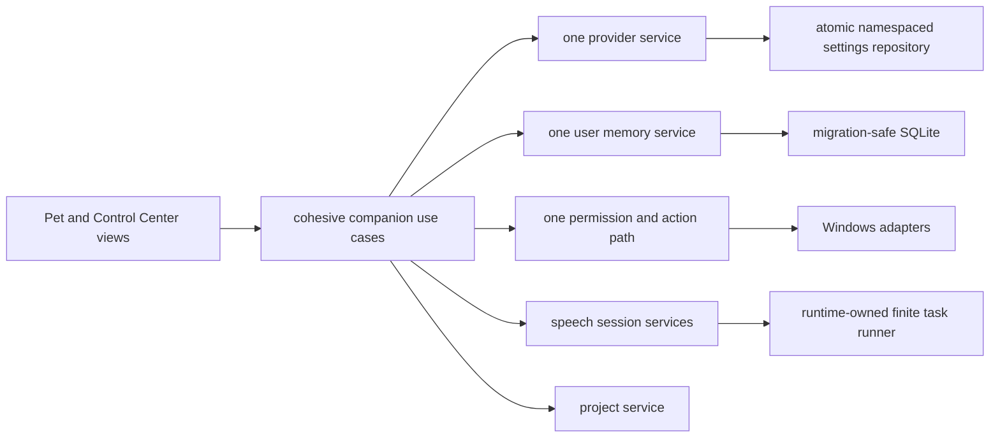

# Fibi Companion Simplification Plan

Date: 2026-07-30

Source audit: [OVERENGINEERING_AUDIT.md](OVERENGINEERING_AUDIT.md)

## Goal And Guardrails

Reduce accidental complexity while preserving the features users would install
Fibi for: the Pet, concise chat, manual Gemini/Ollama selection, reviewed
memory, push-to-talk, safe actions, project help, optional voice, and local
privacy.

Success is not measured primarily by deleted lines. It is measured by fewer
authoritative paths, faster and more reliable startup, stable public contracts,
less internal patching in tests, clearer experimental boundaries, and safer
data migrations.

Guardrails:

- no big-bang Core rewrite or repository-wide move;
- no deletion of user data or tables during initial migrations;
- no silent provider switching;
- no weakening of permissions, confirmations, path checks, or consent;
- no raw audio retention or private payload logging;
- no mandatory optional backend;
- one cohesive migration per pull request with a direct rollback;
- protected wake-runtime work remains isolated until its owner commits it.

## Target Ownership



This remains a modular monolith. Do not introduce a service locator, DI
framework, event bus, or one-class-per-command design.

## Phase 1 - Safe Cleanup

Objective: remove measurable startup and contributor friction without changing
product behavior.

### 1.1 Lazy engine package exports - completed in the audit change

- Replace eager imports in `fibi/engines/__init__.py` with lazy public exports.
- Preserve all 27 names and `from fibi.engines import FibiCore`.
- Verify a lightweight submodule does not load Core, NVIDIA, or generic provider
  modules.
- Baseline: 118 engine modules and 3,887.9 ms for the isolated import.
- Measured result: five engine modules and 290.8 ms for the same one-run probe,
  a 92.5% latency reduction. Core and inactive provider adapters stayed
  unloaded. This is an import-path measurement, not a full GUI startup claim.
- Rollback: revert the initializer and focused subprocess test.

### 1.2 Mark inactive compatibility code

- Add deprecation documentation before deleting `brain/ai.py`, legacy
  `control/` helpers, `rag_memory_engine.py`, and `LegacyMemoryAdapter`.
- Confirm no external compatibility commitment exists in release notes.
- Remove the comment-only `ui/window.py` and unused `WorkerManager` only in a
  dedicated cleanup after caller/release scans.
- Expected scope: 6 to 9 modules eventually removed or archived; no user-visible
  feature change.
- Rollback: restore standalone modules; none own authoritative data.

### 1.3 Make architecture authority explicit

- Treat `docs/ARCHITECTURE.md` as current.
- Add a banner to root `ARCHITECTURE.md` and prior audits identifying them as
  historical snapshots.
- Index this audit and plan from contributor documentation.
- Expected benefit: contributors stop implementing against obsolete provider
  and memory diagrams.

### 1.4 Characterize diagnostics

- Inventory which console lines are consumed by smoke tests/support workflows.
- Replace only unconsumed debug prints with structured logger calls.
- Add a verbose diagnostics setting for safe metadata.
- Never log prompts, responses, transcripts, memory content, API keys, or secret
  action payloads.
- Expected scope: migrate approximately 100 debug prints incrementally, not in
  one mechanical change.

### Phase 1 exit criteria

- full test suite and GUI smoke pass;
- release verifier and secret scan pass;
- lightweight imports do not load Core;
- no product command, provider, permission, memory, or voice behavior changes;
- deprecation candidates have documented callers and rollback.

## Phase 2 - Consolidation

Objective: establish one authority per product domain.

### 2.1 Provider authority

Order:

1. Change all status/health UI reads to `ProviderDiagnostics` and selection
   service data.
2. Add contract tests that manual selection persists and failure never changes
   the selected provider.
3. Stop mirroring generation results into `ModelRouter` fields.
4. Turn `ModelRouter` into a read-only compatibility adapter.
5. Remove its route behavior after one documented release window.
6. Construct only Gemini and Ollama in the default product; expose NVIDIA and
   generic adapters through Labs if a tested use case returns.

Expected result: one selection state, one fallback policy, one diagnostic
snapshot, and fewer than half the current provider-policy touch points. Startup
may also avoid importing unused SDK adapters.

Risk: status or old tests may rely on router fields. Roll back by restoring the
result observer mirror while leaving the new services authoritative.

### 2.2 Memory authority

Order:

1. Build a behavior inventory for every legacy/RAG write, read, update, delete,
   export, consent, and review path.
2. Add a migration test database containing facts, conversations, sensitive
   records, projects, duplicates, and corrupt vector state.
3. Finalize the existing `MemoryService` contract around user-facing behavior,
   not current tables.
4. Implement an idempotent copy from supported legacy records to RAG records
   with provenance and stable source IDs.
5. Run dual-read comparison diagnostics without changing displayed results.
6. Switch recall to the primary service when parity targets pass.
7. Switch writes, edits, exports, and forget operations.
8. Retain legacy tables read-only for at least one release; remove only with an
   explicit user-safe migration and backup policy.

Journals and inner-life events may remain separate tables, but they must not be
presented as duplicate user memory. Pattern, habit, relationship, preference,
and opinion data should consume reviewed memory/events rather than each acting
as another authoritative memory store.

Expected result: one understandable recall/edit/forget model, one repository
contract, predictable duplicate handling, and fewer Core memory branches.

Risk: personal data loss or recall regression. Roll back through immutable
pre-migration backup, dual-read comparison, and a read-path feature flag. Never
drop tables in the first migration.

### 2.3 Settings persistence

Order:

1. Define a small atomic JSON state repository with namespaced reads/updates,
   temp-file replacement, schema version, locking, and unknown-key preservation.
2. Characterize existing defaults and first-run behavior.
3. Move one low-risk domain at a time: visual settings, voice, actions, privacy,
   then confirmations/health.
4. Keep typed domain services; only persistence is shared.
5. Retire import-time provider constants after composition passes resolved
   configuration explicitly.

Expected result: one writer contract instead of at least eight independent
read-modify-write implementations. The benefit is data integrity and clearer
precedence, not merely fewer JSON files.

Risk: settings reset or lost unknown fields. Roll back by read-old/write-both
and retaining original files until migration tests pass.

### 2.4 Action result and orchestration

- Keep `ActionIntent`, `ActionPermissionResult`, and `DesktopActionResult` as
  distinct types because they describe different trust stages.
- Do not collapse safety policy into one generic result.
- Move Core's repeated permission/confirmation/result formatting into one
  action use-case coordinator.
- Remove the two-callback `ActionRouter` only after Core delegates directly to
  that coordinator.

Expected result: route precedence remains visible while Core loses duplicated
action detail. Risk is high because ordering is security-sensitive; rollback is
the existing Core methods.

### 2.5 Shared UI state

- Extract one presenter/controller for submitting chat, receiving responses,
  voice session state, provider status, and action confirmations.
- Keep `FibiPetWindow` and `FibiWindow` as sibling views over the same presenter
  and Core services.
- Split settings pages into focused widgets only as they are touched.
- Do not create a general UI framework.

Expected result: the Pet no longer imports the full 2,134-line Control Center
module at startup. GUI behavior and shared service identity remain unchanged.

Risk: Qt ownership, signals, and wake state. Roll back by retaining inherited
Pet until the sibling-view contract and screenshot smoke tests pass.

### Phase 2 exit criteria

- one authoritative provider path and diagnostic state;
- one primary user-memory path with reversible migration;
- one settings persistence owner;
- no duplicated action orchestration;
- Pet and Center share services without implementation inheritance;
- no increase in deep Core attribute replacement tests.

## Phase 3 - Experimental Isolation

Objective: keep future potential without making experimental systems part of
the default maintenance and startup path.

### Wake word

- Off by default and started only after explicit user enablement.
- Lazy import microphone/wake dependencies.
- Give the controller one lifecycle owner and bounded state transitions.
- Keep raw audio memory-only and log no transcripts.
- Require real-device validation before moving out of Labs.

### RVC

- Off by default; Edge TTS remains the supported fast path.
- Lazy import RVC backends only during requested conversion.
- Keep cache and backend failures visible but nonfatal.
- Add latency/health thresholds before advertising it as stable.

### Labs model backends

- Default registry contains Gemini and Ollama only.
- NVIDIA and generic OpenAI-compatible adapters remain available only behind an
  explicit Labs registration and their own optional dependencies.
- No backend may define Fibi personality, memory, permission, or fallback
  policy.

### Advanced workflows

- Group patch/check/session/recipe/browser-research entry points under Labs.
- Instantiate their repositories and workers on first explicit use.
- Keep deterministic safe actions outside workflow planning.
- Do not build a generic autonomous task platform until two independent,
  user-validated workflows require the same abstraction.

### Phase 3 exit criteria

- default startup creates no microphone, RVC, indexing, or advanced-workflow
  worker;
- Settings labels every experimental capability;
- disabling a feature stops and joins its owned work;
- optional dependency absence cannot prevent text-only Pet startup.

## Phase 4 - Large Migrations

Begin only after Phases 1 to 3 and their rollback paths are stable.

1. Extract cohesive Core coordinators for commands, generation/context, actions,
   memory, and project assistance. Target 5 to 7 use cases, not dozens of tiny
   classes.
2. Split domain dataclasses from the 1,496-line `engines/types.py` while keeping
   compatibility re-exports for one release.
3. Move Windows-specific process/window/clipboard/autostart code behind narrow
   platform protocols and add explicit unsupported-platform results.
4. Add standard project metadata and optional dependency groups only after the
   Windows build/release pipeline consumes them.
5. Consider incremental semantic indexing only after retrieval benchmarks show
   SQLite is insufficient for real user memory volumes.

Expected scope is a staged reduction of Core by roughly 1,500 to 2,500 lines
and retirement of 10 to 20 compatibility/prototype modules. These estimates
are planning ranges, not success criteria.

## Validation Matrix

Every phase must preserve these journeys with mock providers and side effects:

| Journey | Minimum validation |
|---|---|
| Start Fibi and show Pet | runtime lifecycle, package import, GUI smoke |
| Open Control Center | same Core/service identity, no duplicate services |
| Select Gemini manually | persistence, no provider auto-switch |
| Concise chat | mocked generation, response budget/cleanup |
| Select Ollama manually | persistence, no cloud call |
| Open an application | intent, permission, allowlist, mocked launcher |
| Open a registered project | root validation, VS Code resolution, mocked launch |
| Remember and recall | consent, duplicate/update, retrieval, export/delete |
| Push-to-talk | bounded capture, no raw audio storage, UI states |
| Open and save settings | schema/default/migration tests |
| Exit | idempotent shutdown and worker stop/join |

Repository validation remains:

```powershell
python -m compileall -q .
python -m pytest -q
python app.py --gui-smoke
python tools/verify_release.py
```

Also run architecture/document checks, runtime duplicate-service diagnostics,
secret scans, whitespace checks, and any already-installed static analysis.

## Expected Benefits

### Performance

- The completed lazy-export fix targets the measured 3.9-second lightweight
  import and 118-module load cascade.
- Lazy experimental and Labs construction should reduce startup variance and
  optional dependency failures; measure before setting a numeric promise.
- A sibling Pet view should avoid importing Control Center dialogs until used.
- One finite-job owner should improve shutdown reliability more than raw speed.

### Dependencies

- Main installation should eventually contain only Pet/chat/action/Edge-TTS
  requirements.
- RAG embeddings, wake/STT extras, RVC, and Labs providers belong in documented
  optional groups.
- Do not unpin or remove dependencies until import and packaged-build tests
  demonstrate they are optional.

### Contributors

- One answer for provider selection, memory, settings, and background ownership.
- Fewer tests that replace arbitrary Core attributes.
- Smaller review surfaces and explicit compatibility windows.
- Canonical architecture docs distinguish shipping, Labs, compatibility, and
  historical code.

## Regression Risks And Rollback Policy

| Area | Principal risk | Required rollback |
|---|---|---|
| Imports | missing public re-export | restore eager initializer |
| Providers | changed manual selection/fallback | restore router mirror/facade |
| Memory | lost or hidden personal data | backup, dual-read, read-path flag |
| Settings | reset/lost privacy field | preserve old files, write-both |
| UI | Qt ownership/wake regression | retain inherited Pet path |
| Workers | shutdown hang or stale callback | migrate one worker family at a time |
| Legacy removal | external undocumented import | one-release deprecation shim |

No cleanup commit may mix a data migration, behavior change, and module move.
If characterization evidence is incomplete, classify the item `INVESTIGATE`
and stop.

## Recommended Sequence

1. Land the lazy engine export fix and its isolated import test.
2. Mark canonical/historical documentation and inactive compatibility modules.
3. Inventory memory behavior and build migration/parity fixtures.
4. Remove provider diagnostic mirrors after status consumers migrate.
5. Introduce atomic namespaced settings persistence.
6. Extract action orchestration from Core without changing route order.
7. Create sibling Pet/Control Center views over shared presentation state.
8. Centralize finite background work and isolate wake lifecycle.
9. Move Labs systems out of default construction.
10. Only then reduce Core and shared types by cohesive domain.

## Exact Next Task

Create a memory-path characterization suite that records every current
user-visible remember, recall, edit, forget, consent, review, and export outcome
for both legacy and RAG stores. Add an idempotent migration design and parity
report, but do not switch production reads or mutate real user data yet.
